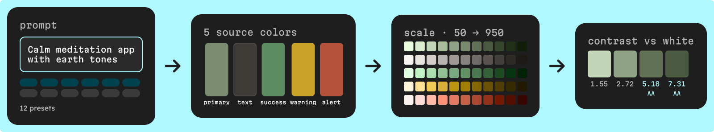

An AI color palette generator turns a few words into colors you can build an interface on. In UI Color Palette, you type a prompt or pick one of 12 presets, and the AI returns five source colors with a fixed role each (primary, text, success, warning and alert), which become a palette with a scale and contrast scores for every shade.

Starting a palette from nothing is the slow part. A prompt gives you all five colors in one pass, already named, so you spend your time on the scale and the contrast.

## How does prompt-to-palette work in UI Color Palette?

AI generation is one of the four tools of the Colors combinator, next to Image palette, Color harmony and Explorer. It runs in the Figma, Penpot, Sketch and Framer plugins, on every plan.

1. **Prompt** — open `AI Colors` and describe a mood, a brand or a product, or pick a preset. Press the generate button, or Ctrl+Enter (Cmd+Enter on a Mac).
2. **Five source colors** — the AI, Mistral AI, returns exactly five colors, one per role. Each color is adapted to its role (an alert color is always reddish) and named after its role and its look, such as `Primary · Crimson Red`.
3. **Scale** — you see the whole palette before you create it. Once you create it, it opens right away, with a scale that turns each source color into a row of shades.
4. **Contrast** — every shade shows its WCAG 2.1 ratio and APCA score, so you can see which shades can carry text.

If the request fails, an error message appears in place of the result, and you can generate again.

The diagram shows an illustrative palette, not a real result: primary `#7A8B6F`, text `#3E3A36`, success `#5E8C61`, warning `#C9A227` and alert `#B5523B`.

## What do the 12 presets ask for?

The presets are ready-made prompts, split into six vibes and six use cases. Click a preset to fill the prompt field with its text; the prompt stays editable, so a preset is a starting point, not a template you are locked into.

| Preset | Kind | Prompt it fills in | Try editing it to |
| --- | --- | --- | --- |
| Cyberpunk | Vibe | Cyberpunk futuristic interface with neon accents | Night-mode music app with neon magenta and cyan accents |
| Minimalist | Vibe | Clean minimalist design with subtle contrasts | Minimalist note-taking app, near-neutral grays, one blue accent |
| Pastel | Vibe | Soft pastel colors for gentle, friendly interface | Soft pastel kids' learning app, friendly and calm |
| Corporate | Vibe | Professional corporate design with trustworthy colors | Corporate banking dashboard, trustworthy navy and slate |
| Nature | Vibe | Natural earth tones inspired by forest and mountains | Hiking trail app with moss green and granite gray |
| Vintage | Vibe | Retro vintage aesthetic with warm, muted colors | Vintage coffee roaster site, warm muted browns and cream |
| Landing page | Use case | Modern landing page for tech startup | Landing page for a developer tool, confident violet |
| Blog | Use case | Personal blog with warm, readable typography | Food blog with warm, readable tones and a tomato red accent |
| Resume | Use case | Professional resume with clean, confident colors | Designer resume, clean and confident, one teal accent |
| Portfolio | Use case | Creative portfolio showcasing artistic work | Photography portfolio, dark and quiet, so the images lead |
| Documentation | Use case | Technical documentation with clear hierarchy | API documentation with clear hierarchy and calm blue links |
| E-commerce | Use case | E-commerce store with conversion-focused colors | Sportswear store with an energetic orange call to action |

The third column is the exact text each preset sends. The fourth is our suggestion of how to make it yours: keep the preset's intent and add your product, your audience and one or two anchor hues.

## How do you write a good prompt for a UI palette?

The AI gets your prompt and no other context from your file, so the prompt is the whole brief. These habits give the most usable results:

- **Name the product and its audience** — "budgeting app for students" says more than "finance".
- **Give two or three mood words** — calm, energetic, premium, playful. More than that and the colors start to pull in different directions.
- **Name an anchor hue in words** — "deep teal", "tomato red", "warm sand". It steers the primary color without dictating the rest.
- **Say where the colors will live** — "dark interface" or "printed menu" changes what a good primary looks like.
- **Skip the status colors** — you always get success, warning and alert, adapted to their role, so the prompt can focus on character.
- **Iterate on one word at a time** — if the result is close, change a single word and generate again, so you can tell what moved.

The plugin's own placeholder gives two good shapes to copy: "Modern tech startup with vibrant energy" and "Calm meditation app with earth tones".

<!-- TODO(asset): Screen Studio clip, 20–25 s, no audio, plugin in light mode. 1) Open AI Colors in the Colors combinator, 2) click the Documentation preset and zoom on the prompt field as it fills with "Technical documentation with clear hierarchy", 3) edit the prompt to "API documentation with clear hierarchy and calm blue links", 4) press Cmd+Enter, 5) zoom on the five generated colors and their role names, 6) create the palette and show it opening with its shades. File: public/videos/ai-color-palette-generator-presets.mp4. Caption link: "Pick a preset prompt, edit it and generate a five-color palette with AI in UI Color Palette". Insert as a link line here. -->

## What should you check after generating?

The AI picks the source colors; how accessible they are depends on the scale and on the pairs you use. Run through these checks once the palette is open:

- **Choose the scale** — Tailwind (11 stops, 50 to 950) and Material 3 (13 stops, 0 to 100) are free with their fixed stops, the other named presets need /pro, and a `Custom` set takes up to 6 stops on /basic and 24 on /pro. Our [comparison of Material 3, Tailwind and Spectrum scales](/blog/material-3-vs-tailwind-vs-spectrum-color-scales) helps you choose.
- **Read every shade's score** — each shade shows its WCAG 2.1 ratio and APCA score against the light and dark foreground colors; hover a ratio to see its A, AA or AAA grade. Body text needs 4.5:1 at level AA ([Understanding SC 1.4.3](https://www.w3.org/WAI/WCAG21/Understanding/contrast-minimum.html)). Look first at the warning color: yellows and ambers reach 4.5:1 on white only in their darkest shades.
- **Don't confuse the two "text" colors** — the generated `Text` color is a source color with its own scale. Scores are measured against the light and dark foreground colors of the color mode, which you can change in its settings.
- **Set contrast targets if a row falls short** — switch the scale to contrast ratios and give each stop the ratio it must reach, as in [how to build an accessible color scale](/blog/how-to-build-an-accessible-color-scale).
- **Check success against alert** — a green and a red at the same lightness are the pair most likely to merge for color-blind users. The protanomaly simulation is free, the other simulations need /pro; our [color blindness checklist](/blog/designing-for-color-blindness-ui-checklist) covers the fixes.
- **Add your color modes** — light and dark each get their own scale and foreground colors; /basic includes 2 color modes.
- **Fix any color by hand** — rename a source color or change its hex in the color list; the AI result is a draft, not a lock.

## What are the limits of AI generation?

- **Always five colors** — primary, text, success, warning and alert, never more or other roles. Add source colors after creating the palette (/basic keeps 5, /pro has no cap).
- **One result at a time** — generating again replaces the previous result.
- **It needs the AI service** — if the request can't complete, you see an error message, with no detail on why.

Outside the design tools, the MCP server's `generate_colors_from_prompt` tool does the same job from Claude or any MCP client, with a prompt of up to 500 characters ([MCP palette tools](https://docs.ui-color-palette.com/mcp/tools/palette#generate_colors_from_prompt)).

## Try it

Open `AI Colors` in your design tool and start with the preset closest to your product. The [AI color palette generator](/capabilities/ai-color-palette-generator) page shows how it fits with the other ways to start a palette, and the docs cover it in [Create a color palette](https://docs.ui-color-palette.com/guides/create-a-color-palette#generate-colors-with-ai).
