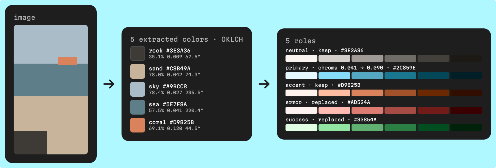
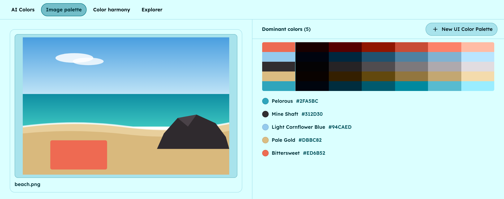

To make a UI color palette from an image, give each extracted color a role, restore the chroma the image lost, and check the contrast of every shade. Keep only the dominant colors that can carry a role (a primary, an accent, a neutral), turn each into a scale of shades, and add what the image can't give you: distinct hues and status colors.

In UI Color Palette, that takes a few minutes, from a PNG to a palette with a scale and contrast scores for every color.

**What you need**: one image or moodboard saved as a PNG, and the UI Color Palette plugin in Figma, Penpot, Sketch or Framer. Image extraction is free on every plan; /basic keeps one palette per page in Figma and Penpot, or per document in Sketch and Framer.

## Why don't the colors from an image make a UI palette?

An extractor finds the colors that cover most of the image, and those are rarely the ones an interface needs. Three things get in the way.

- **Averages dull the colors** — extraction groups similar pixels and returns the average of each group. UI Color Palette uses k-means clustering, which works this way. Average a bright orange `#E8603C` with a blue `#3A6EA5` and you get `#916771`, a dusty mauve that is in neither, with about a third of the orange's chroma.
- **Light creates near-duplicates** — shadows, haze and reflections spread one surface over several tones, so two of your five colors are often the same hue at different lightness.
- **Photos have no status colors** — a beach holds no error red, no success green, and rarely a gray light enough for a page background.

To read the numbers below, we use OKLCH, a perceptual color space that describes a color by its lightness (L, from 0% to 100%), its chroma (C, the distance from gray, 0 for a pure gray) and its hue (H, an angle in degrees). In those terms, the orange above has a chroma of 0.177 and the mauve 0.056.

## How do you choose source colors from an image?

Treat the extracted colors as candidates, and sort them by the job they can do, not by how much of the image they cover.

- **Primary** — the color the image is about, usually mid-lightness with some chroma. It will carry buttons, links and focus states.
- **Accent** — a smaller, more saturated area, like a sunset or a product. It can cover less of the image and still matter more.
- **Neutral** — the darkest or grayest candidate, with a chroma close to 0. Its scale gives you text, borders and surfaces, tinted with the image's mood.
- **Merge or drop the rest** — two candidates close in hue and chroma produce almost the same scale. Keep the stronger one.

Remember what a scale does. A scale is a set of lightness stops applied to every source color, so each stop sets its own lightness. What you really take from the image is hue and chroma; the lightness of the extracted color matters much less.

## Example: from five extracted colors to five roles

Say a beach photo gives the five colors below. They are an illustration of the usual pattern, not the output of a specific image; the OKLCH values and WCAG 2 ratios are computed from the hex codes.

| Extracted color | OKLCH (L, C, H) | What's wrong | Role | Adjustment |
| --- | --- | --- | --- | --- |
| Rock `#3E3A36` | 35.1%, 0.009, 67.5° | Nothing, it's a warm gray | Neutral | Keep it: its scale gives text and surfaces |
| Sand `#C8B49A` | 78.0%, 0.042, 74.3° | 6.8° of hue from the rock: a second neutral | Error | Replace with `#AD524A` (55.0%, 0.121, 26.8°) |
| Sky `#A9BCC8` | 78.4%, 0.027, 235.5° | 15.1° of hue from the sea: the same blue | Success | Replace with `#33854A` (55.1%, 0.121, 149.8°) |
| Sea `#5E7F8A` | 57.5%, 0.041, 220.4° | Only 39% of the chroma sRGB allows at this lightness and hue | Primary | Raise chroma to `#2C859E` (57.6%, 0.090, 220.4°) |
| Coral `#D9825B` | 69.1%, 0.120, 44.5° | 2.88:1 on white, too light for text | Accent | Keep the hue; use darker stops of its scale for text |

The two new colors borrow the coral's chroma (0.120), so they look like they belong to the same image. Both reach 4.5:1 against white, `#AD524A` at 5.14:1 and `#33854A` at 4.57:1. Because they share a lightness, red and green now differ by hue alone: pair them with icons and check them under a color blindness simulation, as our [UI palette checklist for color blindness](/blog/designing-for-color-blindness-ui-checklist) explains.

If you also need a warning color, the coral's orange hue can double as one, or you can add a sixth color on /pro.

## How do you make a palette from an image in UI Color Palette?

The extraction runs inside the plugin, and you see the colors before the palette exists.

### 1 · Bring in the image

Open the `Colors combinator`, then `Image palette`. Drop a PNG or click to browse, paste a PNG with `Ctrl+V` or `Cmd+V`, or, in Figma, Sketch and Framer, select an image on your canvas. The file and clipboard routes accept PNG only, so save a JPEG as a PNG first.

### 2 · Read the extracted colors

Up to 5 dominant colors appear next to the image, with a preview of the palette they would produce. The list isn't ordered by how much of the image each color covers, so sort the colors into roles yourself, with the method above.

The extraction starts from random seeds, so two runs on the same image can differ by a few units, and a small accent area, about 2% of the image in our tests, can be dropped. If you need that color, crop the image around it or enlarge it. The colors in the table above are a simplified illustration, not the output of the beach image below.

### 3 · Create the palette and pick a scale

Create the palette from these colors: it opens right away, with a scale for each color. Then choose the stops. Tailwind (11 stops, 50 to 950) and Material 3 (13 stops, 0 to 100) are free and keep their own fixed stops; a `Custom` set takes up to 6 stops on /basic and 24 on /pro.

### 4 · Reassign the source colors

In `Source colors`, rename each color after its role and type the new hex codes from your table. Names and hex codes are editable on every plan. /basic holds 5 source colors, which a 5-color extraction already fills, so replace near-duplicates instead of adding colors. /pro removes that cap and adds chroma and hue shifts, per color or for the whole palette, with chroma from 0% to 200%.

### 5 · Check contrast and color modes

Every shade shows its WCAG 2.1 ratio and APCA score against the light and dark foreground colors; hover a ratio to see its A, AA or AAA grade. For each role, find the first stop that reaches 4.5:1 for body text and 3:1 for borders and icons, the [WCAG minimums](https://www.w3.org/WAI/WCAG21/Understanding/contrast-minimum.html). Then set up your color modes: /basic includes 2, such as light and dark, each with its own scale and foreground colors.

<!-- TODO(asset): Screen Studio clip, 20–25 s, no audio, Figma, light mode. 1) Open the Colors combinator and click Image palette, 2) drop the beach PNG on the dropzone, 3) zoom on the 5 dominant colors and the preview, 4) create the palette and land in the open palette, 5) in Source colors, rename the sea color "Primary" and type #2C859E, 6) hover the WCAG ratio of a primary shade to show its AA grade. File: public/videos/color-palette-from-image.mp4 (H.264, 1080p, 30 fps, under 8 MB). Then add on its own line: [Turn a PNG into a palette with Image palette in UI Color Palette](/videos/color-palette-from-image.mp4) -->

## Can you build a palette from a moodboard?

Yes, as one image. Image palette reads one image at a time, so combine the moodboard first: export its frame as a PNG, then drop or paste it. A few things change the result.

- **Give each color its area** — every pixel counts toward its group, and the image is reduced to 200 pixels on its longest side before analysis. A thin accent stripe can merge into a larger group, so enlarge it or crop toward it.
- **Cut out the background** — pixels that are more than half transparent are skipped, so a PNG with a transparent background gives the colors of the subject only.
- **Remove what you don't want** — white margins, captions and screenshots of other apps count as colors too.

From Claude or any MCP client, the `extract_dominant_colors` tool does the same from a public JPEG or PNG URL and returns 1 to 16 colors, 5 by default ([MCP palette tools](https://docs.ui-color-palette.com/mcp/tools/palette#extract_dominant_colors)).

## Next steps

- **Compare the ways to bring in an image** — the [image to color palette](/capabilities/image-to-color-palette) page lists the formats, sources and plans, from the plugins to Claude.
- **Make every scale accessible** — [how to build an accessible color scale](/blog/how-to-build-an-accessible-color-scale) sets a contrast target on each stop, so the stops you pick in step 5 behave the same for every color.
- **No image to start from?** — [generate a UI palette from a prompt](/blog/ai-color-palette-generator-from-a-prompt) gives you five colors that already have a role.
- **Read the reference** — the docs cover each tool of the Colors combinator in [Create a color palette](https://docs.ui-color-palette.com/guides/create-a-color-palette#extract-colors-from-an-image).
