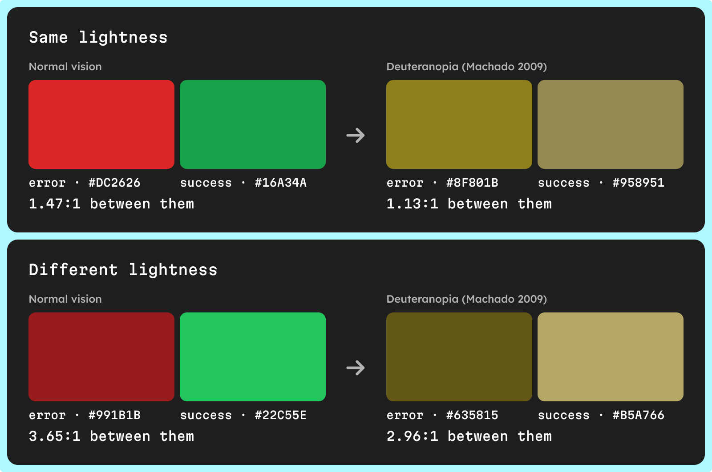

Designing for color blindness means one rule above all: color is never the only way your UI says something. Pair every status color with an icon or text, keep important color pairs apart in lightness rather than hue, label charts directly, underline links, and test the palette under each type of color vision deficiency before it ships.

This guide turns that rule into a checklist for UI palettes, with the WCAG criteria behind each item and the tests that catch what you missed.

## Who does color blindness affect?

Color vision deficiency affects about 1 in 12 men (8%) and 1 in 200 women, roughly 300 million people worldwide, according to [Colour Blind Awareness](https://www.colourblindawareness.org/colour-blindness/). The US [National Eye Institute](https://www.nei.nih.gov/learn-about-eye-health/eye-conditions-and-diseases/color-blindness) gives the same 1 in 12 for men and notes that the most common type makes red and green hard to tell apart.

In practice, almost every product with a few thousand users has color-blind users. There are 8 main types, from protanomaly to achromatopsia, each defined in our glossary. This article is about what to do with your palette.

## What does WCAG require for color blindness?

Two success criteria cover it.

- **[1.4.1 Use of Color](https://www.w3.org/WAI/WCAG22/Understanding/use-of-color.html), level A** — "Color is not used as the only visual means of conveying information, indicating an action, prompting a response, or distinguishing a visual element." The W3C lists "required fields are red" and "error is shown in red" as color-only information.
- **[1.4.11 Non-text Contrast](https://www.w3.org/WAI/WCAG22/Understanding/non-text-contrast.html), level AA** — UI components, their states, and "parts of graphics required to understand the content" need a contrast ratio of at least 3:1 against adjacent colors.

Level A is the minimum level of conformance, so 1.4.1 applies to every audit. Note what it asks: not a color-blind-safe palette, but a second, non-color cue wherever color carries meaning.

## What are the rules for a color-blind-safe UI palette?

### Never use color alone

Treat color as a reinforcement, not the message. If you removed every hue from the screen, each state, category and action should still be identifiable from text, icons, shape, position or lightness.

### Pair status colors with icons and text

Error, warning, success and info are the usual failure. A red border on an invalid field tells a deuteranope nothing that a green border on a valid one doesn't.

- **Errors** — add an error icon and a message that names the problem, next to the field.
- **Success** — add a check mark and a word such as "Saved".
- **Badges and tags** — keep the label inside the badge; a colored dot alone is not a status.

### Separate red and green by lightness, not hue

Take a common pair: error red `#DC2626` and success green `#16A34A`. They look clearly different in normal vision, yet their WCAG contrast ratio against each other is only 1.47:1, so they are close in lightness.

Under a deuteranopia simulation (the Machado et al. 2009 model, severity 1.0, applied in linear sRGB, used here as a reference; simulators, UI Color Palette included, use different models, so their exact colors differ), they become `#8F801B` and `#958951`: two olive tones at 1.13:1. The hue difference was doing all the work, and it is gone.

Move them apart in lightness instead. A dark red `#991B1B` and a mid green `#22C55E` are 3.65:1 apart, and still 2.96:1 apart under the same simulation. Lightness differences survive every type of color blindness; a hue difference alone often doesn't. To build that lightness spacing into a whole palette, see [how to build an accessible color scale](/blog/how-to-build-an-accessible-color-scale).

### Label charts directly

Charts are where color carries the most meaning. A legend that maps five hues to five series forces every reader to match colors, which is the exact task color-blind readers can't do.

- **Label lines and bars directly** — put the series name at the end of the line or on the bar, and the legend becomes optional.
- **Add patterns or markers** — the W3C technique [G111](https://www.w3.org/WAI/WCAG22/Techniques/general/G111) uses color and pattern together; dashed lines, hatched fills and distinct point shapes work.
- **Order series by lightness** — on a sequential scale, step lightness evenly so the order reads without hue.
- **Separate pie slices** — under 1.4.11, slices that need to be told apart need 3:1 against each other, or a contrasting border between them.

### Underline links in text

A link identified only by color fails 1.4.1 unless, per technique [G183](https://www.w3.org/WAI/WCAG22/Techniques/general/G183), it reaches 3:1 against the surrounding text, while still meeting 4.5:1 against the background. The underline is the simpler fix: it works for everyone and needs no ratio. The full link and button math is in [contrast ratio for buttons, borders and text](/blog/contrast-ratio-for-buttons-borders-and-text).

### Give focus and selection a non-color cue

A selected tab that only changes color, or a focus state that only tints the background, relies on color alone. The Understanding document for 1.4.11 notes that a background-only color change for focus "may fail Use of Color (1.4.1)". Add an underline under the selected tab, a check mark in the selected option, a bolder label, or a focus ring with 3:1 against the colors next to it.

## Color blindness checklist for UI palettes

| Pattern | Risk for color-blind users | Fix |
| --- | --- | --- |
| Error and success shown by red and green only | The two states look alike, especially for protan and deutan types | Add an icon and a message; keep the two colors apart in lightness |
| Required or invalid fields marked by a red border | The field looks like any other | Add text such as "Required" or an error message, and an icon |
| Status dots or colored badges without text | The status can't be read | Put the label in the badge, or a distinct icon shape per status |
| Chart series identified by a color legend | Series can't be matched to the legend | Label series directly, add patterns or markers |
| Pie chart slices in similar lightness | Slices merge | 3:1 between adjacent slices, or contrasting borders, plus labels |
| Links colored but not underlined | Links disappear in body text | Underline, or 3:1 against the text per G183 |
| Selected tab or option shown by color only | The current choice is invisible | Underline, check mark or bolder label |
| Focus shown by a background tint only | Keyboard users lose their place | A focus ring with 3:1 against adjacent colors |
| Heatmap or rating scale using red to green | The scale loses its direction | A scale that steps in lightness, with values shown |

## How do you test a palette for color blindness?

1. **Simulate each type, then re-check contrast** — view your palette and key screens under protanopia, deuteranopia and tritanopia at least, plus their partial forms. Look for pairs that merge, not for colors that change, and verify the scores again: a shade that passes against its label in normal vision can lose contrast for some types.
2. **Check in grayscale** — remove all hue and confirm that lightness alone still separates states, series and links from what surrounds them.
3. **Test with people** — ask users with color vision deficiency to complete real tasks, such as fixing a form error or reading a chart. A simulation is a model of average perception; people tell you what actually fails.

## How UI Color Palette helps you design for color blindness

UI Color Palette simulates the 8 types of color vision deficiency on your palette, in its Figma, Penpot, Sketch and Framer plugins.

- **Simulate per color mode** — the vision simulation is a parameter of a color mode, next to its lightness scale and its foreground colors. Add a mode such as "Light – deuteranopia" and switch modes to compare. The /basic plan has 2 color modes; /pro has no limit.
- **Read simulated contrast** — the contrast between your light and dark foreground colors and every shade is simulated too, so the WCAG 2.1 and APCA scores show what each type of vision gets.
- **Start free, go further on /pro** — protanomaly is part of the free /basic plan. The other 7 simulations, including deuteranopia and tritanopia, need /pro, as do the pass/fail filters and the contrast report.
- **Run the grayscale check in place** — on /pro, the achromatopsia simulation shows the palette in lightness only.

<!-- TODO(asset): Screen Studio clip, 15–25 s, MP4 1080p, file public/videos/designing-for-color-blindness-vision-simulation.mp4, caption "Set a deuteranopia simulation on a color mode and watch the shades and contrast scores update". Shot list: in the Figma plugin, open a palette with a red and a green source color; open Color modes; add a color mode and rename it "Light – deuteranopia"; open its parameters and pick Deuteranopia as vision simulation; zoom on the red and green shades as they change and on their WCAG 2.1 and APCA scores (the plugin's own simulation model gives different colors from the Machado example in the article, so don't caption specific tones); switch back to the default mode to compare. -->

## Next steps

- **See the simulator, plan by plan** — the [color blindness simulator for UI palettes](/capabilities/color-blindness-simulation) page lists the 8 types and where each is available.
- **Know what each type changes** — the [types of color blindness](/glossary/color-blindness-types) entry defines protan, deutan, tritan and achromat deficiencies.
- **Check the contrast of your controls** — [contrast ratio for buttons, borders and text](/blog/contrast-ratio-for-buttons-borders-and-text) covers labels, input borders, focus rings and links.
