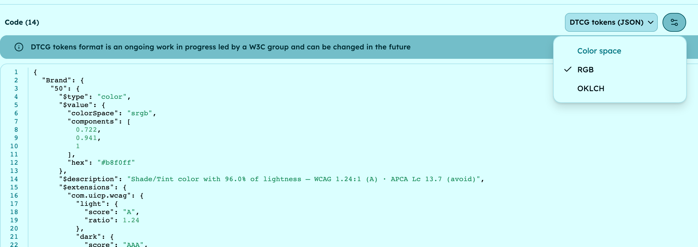
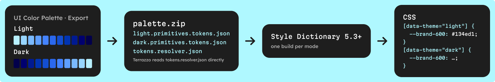

A DTCG color token is a JSON object with `"$type": "color"` and a `$value` made of a `colorSpace`, an array of `components` and an optional `hex` fallback, as defined by the 2025.10 Color module of the W3C Design Tokens Community Group. UI Color Palette exports every shade of your palette in that format, in RGB or OKLCH. Style Dictionary 5.3 or later turns the file into CSS variables with a short config.

Below: what the format is, what one token looks like, then the three steps from your design tool to your CSS, and how modes and semantic tokens fit.

**What you need**: UI Color Palette in Figma, Penpot, Sketch or Framer, on /pro (the DTCG export is a /pro format), and Node.js for Style Dictionary.

## What is the DTCG format?

The Design Tokens Community Group (DTCG) is a W3C community group that writes a vendor-neutral JSON format for [design tokens](/glossary/design-token). Its stable version, [2025.10](https://www.designtokens.org/tr/2025.10/format/), was published on 28 October 2025 in three modules:

- **Format** — the file structure: a token is any object with a `$value`, groups nest tokens, and `.tokens.json` is the recommended file extension.
- **[Color](https://www.designtokens.org/tr/2025.10/color/)** — how a color value is written, in one of 14 color spaces, such as `srgb`, `oklch` and `display-p3`.
- **[Resolver](https://www.designtokens.org/tr/2025.10/resolver/)** — how several token files combine into one result per context, such as a light and a dark mode.

The group notes that the format "is not a W3C Standard", but calls it stable, and tools such as Style Dictionary and Terrazzo are implementing it.

## What does a DTCG color token look like?

Here is the 600 stop of a Brand color started from `#2563EB` with the Tailwind preset, as UI Color Palette exports it in RGB:

```json
{
  "Brand": {
    "600": {
      "$type": "color",
      "$value": {
        "colorSpace": "srgb",
        "components": [0.075, 0.306, 0.82],
        "hex": "#134ed1"
      },
      "$description": "Shade/Tint color with 48.0% of lightness — WCAG 6.91:1 (AA) · APCA Lc 88.0 (content text)",
      "$extensions": {
        "com.uicp.wcag": {
          "light": { "score": "AA", "ratio": 6.91 },
          "dark": { "score": "A", "ratio": 3.04 }
        },
        "com.uicp.apca": {
          "light": { "score": 88.01, "recommendation": "CONTENT_TEXT" },
          "dark": { "score": 21.06, "recommendation": "NON_TEXT" }
        }
      }
    }
  }
}
```

Each field has one job:

- **`$type`** — tells tools this token is a color.
- **`colorSpace` and `components`** — the color itself. In `srgb`, each channel goes from 0 to 1: `0x13` is 19/255, or 0.075.
- **`hex`** — an optional fallback in 6-digit CSS notation, for tools that only read hex.
- **`$extensions`** — vendor data under a reverse-domain key, as the format recommends. Here, the WCAG 2.1 ratio and grade and the APCA score of the shade against your light and dark text colors (white and black by default).

With [OKLCH](/glossary/oklch) selected, the same token reads `"colorSpace": "oklch"` and `"components": [0.48, 0.21, 263]`: lightness from 0 to 1, chroma, and hue in whole degrees. The `hex` fallback stays `#134ed1`.

## 1 · Export the palette as DTCG tokens

Build your palette first: source colors, a scale preset, and a color mode per theme. Then:

1. Open the **Export** tab and choose **DTCG tokens** in the format menu.
2. Pick the color space: **RGB** (the default) or **OKLCH**.
3. Copy the code, or download it.

Every shade of every source color becomes a token, source color included, named by color and stop: `Brand.50` to `Brand.950`, plus `Brand.source`. The export reflects the palette as it is now, so export again after each change.



## 2 · Build CSS with Style Dictionary

[Style Dictionary](https://styledictionary.com/) is an open-source build system that reads token files and writes them for each platform: CSS, SCSS, iOS, Android and more. It has read the [DTCG format since v4](https://styledictionary.com/info/dtcg/), and it converts the 2025.10 color objects since [version 5.3.0](https://github.com/style-dictionary/style-dictionary/releases/tag/v5.3.0). Earlier versions, v4 included, write `[object Object]` instead of a color.

With one color mode, the download is a single JSON file named after your palette in snake case, such as `brand_palette.json`. Put it in `tokens/`, then add this `config.json` next to that folder:

```json
{
  "source": ["tokens/**/*.json"],
  "platforms": {
    "css": {
      "transformGroup": "css",
      "buildPath": "build/css/",
      "files": [{ "destination": "variables.css", "format": "css/variables" }]
    }
  }
}
```

Run `npx style-dictionary build`. With the RGB export, you get:

```css
:root {
  --brand-500: #2b68ee; /** Shade/Tint color with 56.0% of lightness … */
  --brand-600: #134ed1; /** Shade/Tint color with 48.0% of lightness … */
  --brand-source: #2563eb; /** Source color */
}
```

Every name goes to kebab case, and each `$description` becomes a comment, contrast summary included.

If you want `oklch()` values instead, use the OKLCH export and swap the `color/css` transform for `color/oklch` in a JavaScript config. Keep the RGB export for hex output: Style Dictionary converts the rounded OKLCH components, so the 600 stop comes out as `#144ed1` instead of `#134ed1`.

## 3 · Handle light and dark modes

With several color modes, you download a zip instead of a single file:

- **One file per mode** — `light.primitives.tokens.json`, `dark.primitives.tokens.json`, each with every shade of that mode.
- **`tokens.resolver.json`** — a [Resolver](https://www.designtokens.org/tr/2025.10/resolver/) file that maps each mode to its file and names the first mode as the default.

A resolver-aware tool such as [Terrazzo](https://terrazzo.app/) reads the resolver directly. Style Dictionary does not read resolvers yet; [support is tracked](https://github.com/style-dictionary/style-dictionary/issues/1590) but not started. Until then, build each mode on its own, under its own selector:

```js
import StyleDictionary from 'style-dictionary';

for (const mode of ['light', 'dark']) {
  const sd = new StyleDictionary({
    source: [`tokens/${mode}.primitives.tokens.json`],
    platforms: {
      css: {
        transformGroup: 'css',
        buildPath: 'build/css/',
        files: [{
          destination: `${mode}.css`,
          format: 'css/variables',
          options: { selector: `[data-theme="${mode}"]` },
        }],
      },
    },
  });
  await sd.buildAllPlatforms();
}
```

Each file then sets the same `--brand-*` names under `[data-theme="light"]` or `[data-theme="dark"]`.



## What can go wrong?

- **`[object Object]` in your CSS** — your Style Dictionary is older than 5.3.0. Upgrade it, or use the Style Dictionary v3 format in a v3 project.
- **Tokens that lag behind the design** — the export is a snapshot. Export again after each palette change, and commit the token files so the diff shows which shades moved.
- **Two sources of truth** — the CSS export writes OKLCH lightness as a whole percentage, while the DTCG export keeps three decimals. Pick one export and generate everything else from it.
- **A hard-coded mode list** — the loop above names its modes. When you add a color mode, add its file name too.

## Which token format should you pick?

UI Color Palette writes several JSON formats besides DTCG. Pick the one your tool reads:

| Format | File | Color values | Where and plan |
| --- | --- | --- | --- |
| DTCG tokens | One JSON file named after the palette, or a zip with one `*.primitives.tokens.json` per mode and `tokens.resolver.json` | sRGB or OKLCH components, plus hex | Figma, Penpot, Sketch, Framer; /pro |
| Style Dictionary v3 | One JSON file, modes nested inside | Hex | Figma, Penpot, Sketch; /pro |
| Native tokens | One JSON file, one token set per mode | Hex | Figma, Penpot, Sketch, Framer; /pro |
| Universal JSON | One JSON file | Every color space value of each shade | Figma, Penpot, Sketch; /pro |
| CSS custom properties | One CSS file | RGB, hex, HSL, LCH, OKLCH or P3 | Every platform; free |

The Style Dictionary v3 format uses the legacy `value` and `type` keys. Keep it for a v3 project; on Style Dictionary 5.3 or later, use the DTCG export. Native tokens target Tokens Studio and Penpot, and the CSS export is the only free format.

## What about semantic tokens?

The design-tool Export writes the primitives: one token per shade, named by color and stop. Roles such as `action.primary.default` come from a color system.

With a color system built through Claude, the MCP server or the API, `generate_code` writes the primitives file and a semantic file whose tokens are aliases to the primitive shades. With several modes, you get one semantic file per mode, referenced in the resolver next to its primitives. To design that layer, read [how to structure semantic color tokens on top of primitives](/blog/primitive-vs-semantic-color-tokens).

## Next steps

- **Compare every token format and platform** — the [export design tokens](/capabilities/export-design-tokens) page lists the formats, what each holds and where it is available.
- **Ship the same palette to Tailwind** — [generate a Tailwind v4 OKLCH palette from Figma](/blog/tailwind-v4-oklch-palette-from-figma) covers the `@theme` file and the free `oklch()` CSS export.
- **Read the format reference** — the docs detail each export in [Export a color palette to code](https://docs.ui-color-palette.com/guides/export-a-color-palette-to-code).
