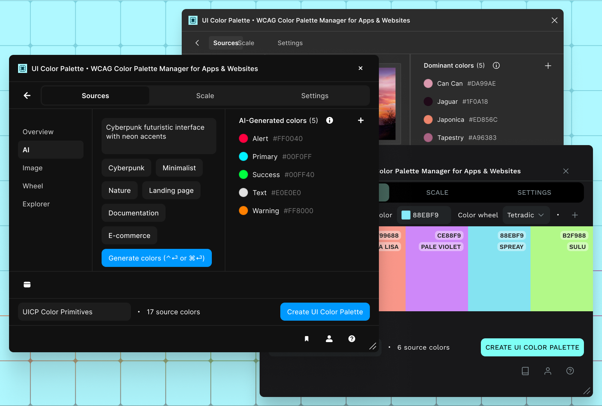
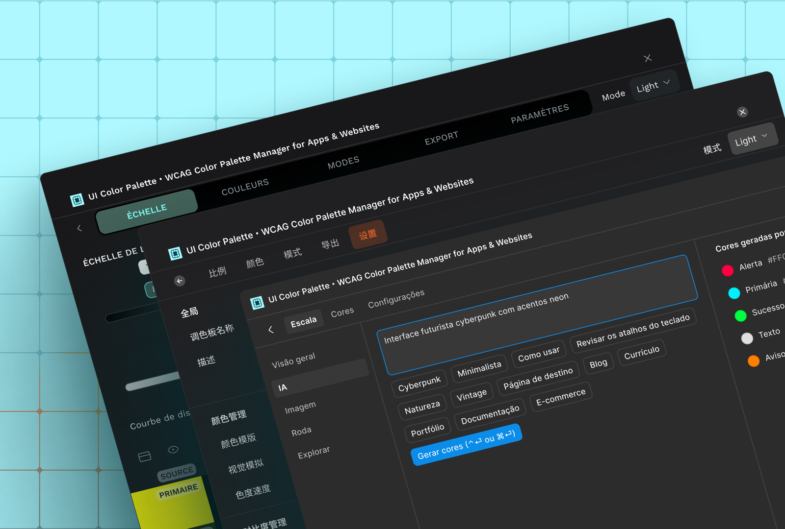
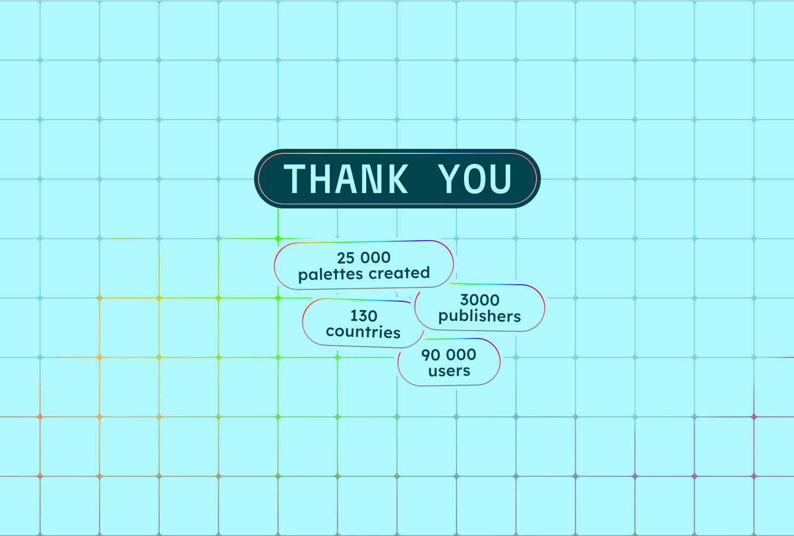

2025 was a pivotal year for UI Color Palette. What started as a simple Figma plugin has transformed into a cross-platform mini-app, available on four platforms, speaking four languages, and powered by AI tools. Here's a look back at a year of transformation.

## Multi-Platform Expansion

The goal was clear: make UI Color Palette available wherever designers work. Mission accomplished.

- **August** — Launched on Penpot, the open-source alternative to Figma
- **September** — Released on Sketch, the historic reference in interface design
- **October** — Deployed on Framer, for designers who code

With Figma as the foundation, UI Color Palette is now available on 4 major platforms. A completely rebuilt architecture allows the app to work independently of the host tool — everything happens directly in the interface.

## AI-Powered Color Tools

Artificial intelligence made its way into UI Color Palette with three new tools:

### AI Generation

Describe your intent, and AI generates a coherent palette. Powered by Mistral, this tool significantly speeds up the creative exploration phase.

### Image Extractor

Import an image, extract dominant colors. Perfect for creating palettes from visual references, photos, or existing illustrations.

### Color Wheel

A classic tool reimagined for creating color harmonies: complementary, triadic, analogous... All with real-time preview.

## An App That Speaks Your Language

Color is universal — now the interface is too. UI Color Palette is available in four languages:

- 🇬🇧 English
- 🇫🇷 French
- 🇧🇷 Brazilian Portuguese
- 🇨🇳 Mandarin Chinese

This localization isn't just translation — it's a cultural adaptation so every designer feels at home.

## What's Next?

2026 is shaping up to be just as ambitious. The direction is clear: extensibility.

The goal isn't simply to add features, but to build a reproducible model. An architecture that enables rapid deployment to new platforms, integration of new services, and app evolution without rebuilding from scratch.

UI Color Palette is no longer a plugin — it's a mini-app. And this mini-app is built to grow.

## Thank You

To you, the **90,000 users** across **130+ countries** who use UI Color Palette every day. And to the **3,000 members** who created accounts to publish their palettes to the cloud.

This transformation wouldn't have been possible without your trust and feedback. 2025 was just the beginning.

Want to discover all the updates in detail? Check out the [full changelog](https://uicp.ylb.lt/whats-new). You can also [share your ideas](https://uicp.ylb.lt/ideas) and [join the community](https://uicp.ylb.lt/community) to participate in shaping the future of UI Color Palette.
