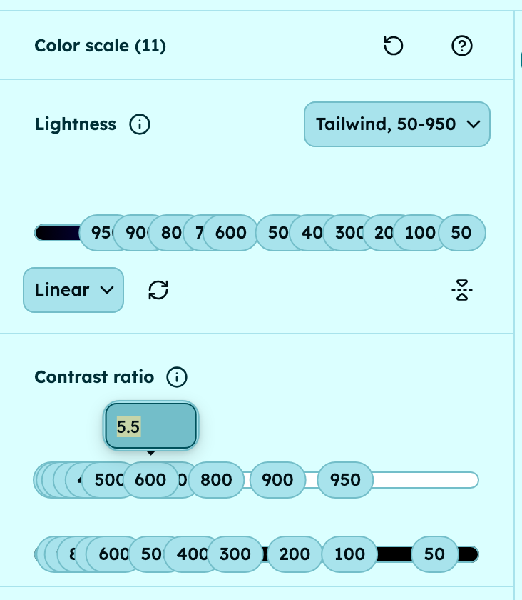
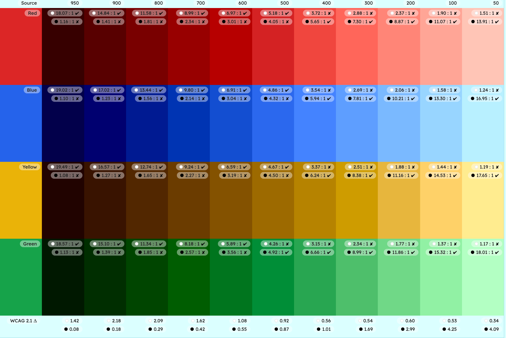

An accessible color scale gives every stop a contrast target instead of a lightness value, spaced so that a fixed distance between two stops guarantees a ratio, such as 4.5:1 for body text. Check every hue against those targets in light and dark mode, with WCAG 2 first and APCA second, then write down the allowed pairs.

The method below works in any tool. The last section shows how to do it in UI Color Palette.

**What you need**: your source colors, the text colors your interface uses, and a contrast checker. The UI Color Palette steps work on the free /basic plan in Figma, Penpot, Sketch and Framer; the analysis tools need /pro.

## 1 · Pick a perceptual color space

A scale is only as even as the lightness it is built on. In HSL, two colors at the same lightness can be far apart in contrast; in a perceptual space such as OKLCH, the same stop lands close from one hue to the next. We compared them in [OKLCH vs HSL for UI palettes](/blog/oklch-vs-hsl-for-ui-palettes).

HSLuv goes one step further: its lightness is computed from luminance alone, like the WCAG 2 ratio, so equal HSLuv lightness gives practically equal ratios. OKLCH lightness is close to luminance, not identical, as step 5 shows.

## 2 · Choose the stops and how to name them

Pick one set of stops and use it for every color. Common conventions:

- **50 to 950** — 11 stops, as in Tailwind.
- **100 to 900** — 9 stops, as in Bootstrap.
- **0 to 100** — 13 stops, as in Material 3, where the number tracks lightness.

The name is a promise: blue 600 and green 600 should carry the same text in the same way. It only holds if each stop has a fixed contrast, which is the next step.

## 3 · Set a contrast target for each stop

Instead of "600 is 45% lightness", write "600 reaches 5.55:1 against white". One property of the WCAG 2 ratio makes this easy to plan: a color's ratio against white times its ratio against black always equals 21. So every color reaches at least 4.58:1 (√21) against one of the two, and only a color between 4.5:1 and about 4.67:1 against white passes 4.5:1 against both.

Here is an 11-stop scale where each target is the previous one multiplied by 1.32. These are illustrative targets, not a standard.

| Stop | Target vs white `#FFFFFF` | Same color vs black `#000000` | Typical use in light mode |
| --- | --- | --- | --- |
| 50 | 1.05:1 | 20.00:1 | Page background |
| 100 | 1.39:1 | 15.11:1 | Subtle fills, hover backgrounds |
| 200 | 1.83:1 | 11.48:1 | Selected rows, soft badges |
| 300 | 2.41:1 | 8.71:1 | Decorative dividers only |
| 400 | 3.19:1 | 6.58:1 | Input borders, icons on white |
| 500 | 4.21:1 | 4.99:1 | Large text on white; fills behind black text |
| 600 | 5.55:1 | 3.78:1 | Body text on white; fills behind white text |
| 700 | 7.33:1 | 2.86:1 | Body text at level AAA |
| 800 | 9.68:1 | 2.17:1 | Headings |
| 900 | 12.77:1 | 1.64:1 | Dark mode surfaces |
| 950 | 16.86:1 | 1.25:1 | Dark mode page background |

The thresholds per level are in our [WCAG contrast ratio](/glossary/wcag-contrast-ratio) entry. The uses above take the level AA ones: 4.5:1 for body text and 3:1 for large text ([SC 1.4.3](https://www.w3.org/WAI/WCAG22/Understanding/contrast-minimum.html)), 3:1 for borders and icons ([SC 1.4.11](https://www.w3.org/WAI/WCAG22/Understanding/non-text-contrast.html)). The "vs black" column is 21 divided by the rounded target.

## 4 · Decide the pairing rules

When both stops are measured against the same white, the contrast between them is simply the ratio of their targets: 600 text on a 100 fill is 5.55 ÷ 1.39 = 3.99:1. With a constant factor per stop, the distance between two stops sets the contrast:

- **4 stops apart** — at least 3.03:1: large text, borders, icons.
- **6 stops apart** — at least 5.27:1: body text, with headroom above 4.5:1.
- **8 stops apart** — at least 9.19:1: body text at level AAA, with room to spare.

Five stops apart gives only about 4:1, which is why the body-text rule is six.

The U.S. Web Design System uses the same idea with a 0 to 100 grade: "We call the difference in grade between any two colors the magic number." In its [color documentation](https://designsystem.digital.gov/design-tokens/color/overview/), a magic number of 50 or more gives WCAG AA contrast, and 70 or more gives AAA.

## 5 · Check every hue at every stop

A target sets a stop's lightness, but the ratio you get still depends on hue and chroma. Here are four colors at the same OKLCH lightness of 57%, measured against white text:

| Color | OKLCH | Hex | vs white | Body text (4.5:1) |
| --- | --- | --- | --- | --- |
| Red | `oklch(57% 0.15 27)` | `#C04D44` | 4.79:1 | Pass |
| Blue | `oklch(57% 0.15 260)` | `#3F75CE` | 4.52:1 | Pass |
| Yellow | `oklch(57% 0.117 95)` | `#8D7600` | 4.44:1 | Fail |
| Green | `oklch(57% 0.15 145)` | `#2F8D39` | 4.21:1 | Fail |

The yellow chroma is 0.117 because that is the most the sRGB gamut allows at this lightness. Measure each color at each stop, and keep headroom: the six-stop rule lands at 5.27:1, not 4.5:1, to absorb that spread.

## 6 · Plan light and dark modes

In dark mode, the roles flip: 900 and 950 become surfaces, and 50 to 200 carry text. Because the WCAG 2 ratio ignores which color is in front, the pairing rules still hold: 100 text on a 900 surface is 8 stops apart.

Measure against the surfaces you actually ship, not pure black, and give each mode its own text colors. A dark surface that is lighter than `#000000` lowers every ratio on it.

## 7 · Verify with WCAG 2, then refine with APCA

WCAG 2 is the rule audits check. APCA, a candidate method for WCAG 3, rates perceived contrast and treats light text on dark differently. We compared both in [APCA vs WCAG 2: what changes for UI colors](/blog/apca-vs-wcag-2-what-changes-for-ui-colors).

Run your pairs through both. Here is a neutral scale built on the targets above, computed with the WCAG 2 formula and APCA-W3:

| Pair (text on background) | Distance | WCAG 2 | APCA |
| --- | --- | --- | --- |
| 600 `#686868` on 50 `#F9F9F9` | 6 stops | 5.29:1 | Lc 74.3 |
| 700 `#565656` on 50 `#F9F9F9` | 7 stops | 6.97:1 | Lc 81.9 |
| 200 `#BFBFBF` on 800 `#444444` | 6 stops | 5.30:1 | Lc −57.0 |
| 100 `#DADADA` on 900 `#323232` | 8 stops | 9.17:1 | Lc −78.6 |

WCAG 2 rates both six-stop pairs the same. APCA puts the light one just under Lc 75, its minimum for body text, and the dark one under Lc 60, its level for content text that isn't body text ([APCA in a Nutshell](https://git.apcacontrast.com/documentation/APCA_in_a_Nutshell.html)). So refine the rule: body text sits 7 stops apart in light mode and 8 in dark mode.

## 8 · Document the allowed pairs

A scale is accessible when people use it the right way, so publish the pairs, not just the colors:

- **Name each pair** — for example, body text is 700 on 50 in light mode and 100 on 900 in dark mode.
- **Record both scores** — the WCAG 2 ratio, its level, and the APCA value.
- **State what it may carry** — body text, large text, or borders and icons only.

## How do you build an accessible scale in UI Color Palette?

UI Color Palette applies one scale to all your source colors and scores every shade, in its Figma, Penpot, Sketch and Framer plugins.

- **Start from a preset** — Tailwind (11 stops, 50 to 950) and Material 3 (13 stops, 0 to 100) are on every plan, the other named presets on /pro. A preset keeps its own stops: you can't add or remove any. A `Custom` set takes up to 6 stops on /basic and 24 on /pro.
- **Type targets, not lightness** — switch the scale from `Lightness` to `Contrast ratio` and enter each stop's ratio against the light or dark foreground color, from 1 to 21. The stop's lightness is recomputed to meet it, other stops may shift to keep the scale in order, and both views edit the same scale. The docs note that this mode works very well with HSLuv, a /pro color space.
- **Set each color mode** — a color mode has its own lightness scale, its own light and dark foreground colors, and its own palette background, so your dark mode gets its own targets. /basic includes 2 color modes.
- **Read every shade** — each shade shows its WCAG 2.1 ratio and APCA score against both foreground colors; hover a ratio to see its A, AA or AAA grade.
- **Catch the weak hue on /pro** — the score interval shows the gap between the lowest and highest score at a stop, across your colors, which is step 5 at a glance. Pass and fail filters and the contrast report add the details.

<!-- TODO(asset): Screen Studio clip, 15–20 s, no audio. 1) Open the Scale panel with the Tailwind preset, 2) toggle from `Lightness` to `Contrast ratio`, 3) type 5.55 on stop 600 and watch the shades update in the Preview, 4) hover the WCAG ratio of a 600 shade to show its AA grade. Zoom on the ratio field, then on the tooltip. File: public/videos/accessible-color-scale-contrast-targets.mp4. Caption link: "Set a target contrast ratio on a stop and read its WCAG grade in UI Color Palette". -->

The docs explain each setting in [Adjust the contrast configuration](https://docs.ui-color-palette.com/guides/master-a-color-palette#adjust-the-contrast-configuration).

## Next steps

- **See every contrast tool, plan by plan** — the [accessible color palette with WCAG and APCA contrast](/capabilities/wcag-apca-contrast) page lists what you get on /basic and /pro.
- **Apply the pairs to components** — [contrast ratio for buttons, borders and text](/blog/contrast-ratio-for-buttons-borders-and-text) lists which colors to compare for labels, input borders and focus rings, state by state.
