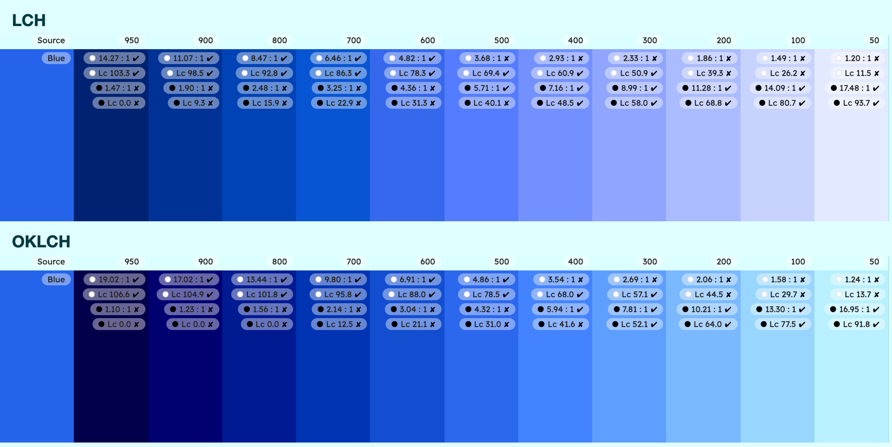
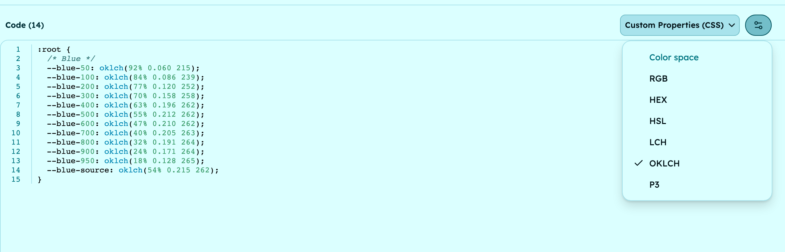

For a design system, pick OKLCH. LCH and OKLCH both describe colors by lightness, chroma and hue, and both work in every major browser, but OKLCH keeps a hue steady where LCH bends blues toward purple, and it is the space CSS Color 4 uses to bring out-of-gamut colors back on screen.

Keep LCH when your pipeline already speaks CIELAB: print proofs, ICC profiles, measured brand colors. Here is the comparison, what each choice means for your CSS and your tokens, and how to set it per palette.

## LCH vs OKLCH at a glance

Both are polar color spaces: a lightness, a chroma (how colorful) and a hue angle. They differ in the model underneath, and that model decides how they behave in a design system. For the definitions, see [what LCH is](/glossary/lch).

| | LCH (CIE LCh) | OKLCH |
| --- | --- | --- |
| Built on | CIELAB, CIE, 1976 | OKLab, Björn Ottosson, 2020 |
| White point | D50 | D65, the same as sRGB |
| Lightness | 0 to 100 | 0 to 1, or 0% to 100% |
| Chroma | 0 to about 230 in practice; 100% = 150 | 0 to about 0.5 in practice; 100% = 0.4 |
| Hue of pure red (`#FF0000`) | About 41° | About 29° |
| Hue held as chroma drops | Blues drift toward purple | Holds |
| CSS function | `lch()`, CSS Color 4 | `oklch()`, CSS Color 4 |
| Browser support | All major browsers since May 2023 | All major browsers since May 2023 |
| DTCG `colorSpace` value | `"lch"` | `"oklch"` |
| Typical use | Print, ICC color management, Lab image editing | UI palettes, design tokens, CSS |

Ranges and white points come from [CSS Color Module Level 4](https://www.w3.org/TR/css-color-4/#specifying-lab-lch), and browser support from MDN's pages on [`lch()`](https://developer.mozilla.org/en-US/docs/Web/CSS/Reference/Values/color_value/lch) and [`oklch()`](https://developer.mozilla.org/en-US/docs/Web/CSS/Reference/Values/color_value/oklch).

One row deserves a warning before you migrate anything: the numbers do not carry over. The same red is 41° in LCH and 29° in OKLCH, and pure blue has a lightness of 29.6 in LCH but 0.452 in OKLCH. Convert colors, never copy channel values.

## Why does LCH turn blues purple?

CIELAB dates from 1976, and its weak spot is blue. CSS Color 4 [describes it directly](https://www.w3.org/TR/css-color-4/#cie-lab): between LCH hues 270° and 330°, "visual hue departs from what LCH predicts", and "as a saturated blue has its Chroma progressively reduced, it becomes noticeably purple."

We ran the test on sRGB primary blue, `#0000FF`. In each space, we kept its lightness and hue fixed and reduced the chroma by quarters.

| Chroma kept | LCH, hue held at 301.4° | OKLCH, hue held at 264.1° |
| --- | --- | --- |
| 100% | `#0000FF` | `#0000FF` |
| 75% | `#4022CE` | `#0A3DD5` |
| 50% | `#4D329F` | `#274EAB` |
| 25% | `#4E3D72` | `#3F5582` |

Paste the left column into any color picker and it turns violet; the right column stays blue. Measured in OKLCH, the LCH colors move from 264° to 297°, about halfway toward magenta at 328°. OKLab was built, in the words of [CSS Color 4](https://www.w3.org/TR/css-color-4/#ok-lab), with "improved hue linearity, hue uniformity, and chroma uniformity compared to CIE LCH."

In a design system, low chroma is where you spend most of your blue: page backgrounds, subtle surfaces, borders, disabled states, tinted neutrals. In LCH those are the shades that drift, so a pale blue surface can read lavender next to your brand blue. In OKLCH, the tint and the brand color share one hue.

## How do lightness and chroma behave?

Both spaces have a perceptual lightness, so a step in L looks like a step whatever the hue. That is the shared advantage over HSL, covered in [OKLCH vs HSL for UI palettes](/blog/oklch-vs-hsl-for-ui-palettes); between LCH and OKLCH, the differences are elsewhere.

- **Scale of the numbers** — LCH lightness runs from 0 to 100, OKLCH from 0 to 1. Your token docs, your converters and your lint rules must agree on which one they read.
- **Chroma is absolute in both** — a chroma value means roughly the same colorfulness on any hue. The most colorful value a screen can show depends on hue and lightness, so a single chroma across a whole palette will overshoot on some hues.
- **Chroma uniformity** — OKLCH spaces chroma more evenly, so equal chroma steps look closer to equal, which helps when you derive muted variants from a brand color.

## What happens to colors outside the gamut?

Neither space has a gamut limit of its own, so both functions can describe colors no sRGB screen can show, Display P3 colors included. When the browser meets one of those, it has to map it back.

[CSS Color 4 defines how](https://www.w3.org/TR/css-color-4/#css-gamut-mapping), and it does it in OKLCH: "All three CSS gamut mapping algorithms aim at constant-lightness, constant-hue chroma reduction in the OkLCh color space." The same spec warns that ["simple gamut mapping in CIE LCH would give unsatisfactory results"](https://www.w3.org/TR/css-color-4/#GM-excessive-reduction).

So even if you author your tokens in `lch()`, the fallback the spec defines is computed in OKLCH. Authoring in OKLCH means you design in the same space the spec repairs in: a shade that is too vivid loses chroma, and keeps its lightness and hue.

For a design system, two rules follow:

- **Keep core tokens in sRGB** — text, borders and surfaces should never depend on gamut mapping, because a contrast score you checked could shift on another screen.
- **Go wide on purpose** — vivid accents beyond sRGB are fine on P3 screens, as long as you know which tokens they are and check them on a real display.

## Which one fits your CSS and token pipeline?

Support does not decide it: `lch()` and `oklch()` are both in CSS Color 4 and both work in every major browser. The ecosystem around them does.

- **CSS interpolation** — when a syntax doesn't name a color space for interpolation, CSS Color 4 [defaults to Oklab](https://www.w3.org/TR/css-color-4/#interpolation-space), the Lab form of OKLCH. Colors written in legacy syntax, such as hex, keep interpolating in sRGB.
- **Design tokens** — the [Design Tokens Color Module 2025.10](https://www.designtokens.org/tr/2025.10/color/#supported-color-spaces) accepts both `"lch"` and `"oklch"` as a token's `colorSpace`, with a `components` array and an optional `hex` fallback. Both are valid; pick one and stick to it across the file.
- **Tailwind CSS** — since v4.0, Tailwind has [upgraded the entire default color palette from rgb to oklch](https://tailwindcss.com/blog/tailwindcss-v4#modernized-p3-color-palette). If your product uses Tailwind, OKLCH tokens sit next to its defaults without conversion.

The result is a pipeline with one color space end to end: the design file, the tokens, the CSS and the gamut mapping CSS Color 4 defines. With LCH, the spec still gamut-maps in OKLCH, so you add a conversion your team has to keep in mind.

## When does LCH still make sense?

LCH is not obsolete. It is the right choice when your colors already live in CIELAB.

- **Print and measured color** — CSS Color 4 notes that D50 is the white point of the ICC profile connection space, of image editors that offer Lab editing, and of spectrophotometers that report measured colors in Lab. If your brand book gives Lab values, `lch()` keeps them one step away.
- **Existing tooling** — if your color-difference checks, your scripts or your vendors work in CIELAB, switching only the UI layer to OKLCH creates two sources of truth.
- **Tokens already shipped in lch()** — they render correctly in every major browser. Migrate when you rework the palette, not for its own sake.

Even then, watch the blues. If your palette has a blue brand color, compare its pale shades in both spaces before you settle.

## How do you choose LCH or OKLCH in UI Color Palette?

In UI Color Palette, the color space is a setting of each palette, and the shades are computed in it. It works the same way in Figma, Penpot, Sketch and Framer.

### 1 · Pick the color space of the palette

Every new palette starts in OKLCH. To change it, open the palette settings, or the settings of the preview panel while you edit, and pick LCH. OKLCH, LCH and HSL work on every plan; CIELAB, OKLab and the other spaces need /pro.

The change applies at once and recomputes every shade. Your source colors and your scale stay as they are, so you can switch back and forth to compare.

<!-- TODO(asset): Screen Studio clip, 10–15 s — open a palette with a blue source color in OKLCH; open the palette settings; pick LCH in the color space dropdown (zoom on it); the shades recompute; pick OKLCH again. Expected result: the pale blue shades lean toward purple in LCH and return to blue in OKLCH (check this on the real scale before recording; pick a source color around #2563EB if the drift is too subtle). Save as public/videos/lch-vs-oklch-for-design-systems-switch.mp4 -->

### 2 · Compare the pale blues

Look at the lightest stops of your blue scale in each space: low-chroma blues are where LCH can drift toward purple. Each shade shows its WCAG 2.1 and APCA score, so you can check that the stops you use for text still clear their threshold after the switch.

### 3 · Export lch() or oklch() values

The CSS, SCSS and Less exports let you choose the color model of the values they write, including `lch()` and `oklch()`, on every platform. CSS export works on every plan; SCSS and Less need /pro. Through Claude or the MCP server, `generate_code` takes `LCH` or `OKLCH` in its `colorSpace` option.

If your design system consumes tokens rather than stylesheets, see the [design token exports](/capabilities/export-design-tokens): DTCG, Style Dictionary and native JSON. The DTCG export writes its values in RGB or OKLCH, not LCH, so an OKLCH palette reaches your tokens without conversion. Tailwind v4 has its own export. Every export format except CSS needs /pro.

## Which should you choose: LCH or OKLCH?

- **Pick OKLCH by default** — blues stay blue as chroma drops, and CSS Color 4 gamut-maps in OKLCH.
- **Both are native CSS** — `lch()` and `oklch()` are in CSS Color 4 and in every major browser since May 2023.
- **Tokens take either** — DTCG accepts `"lch"` and `"oklch"`; Tailwind v4 ships its defaults in OKLCH, and the UI Color Palette DTCG export writes OKLCH.
- **Keep LCH for CIELAB pipelines** — print, ICC profiles and measured brand colors.
- **Convert, never copy** — hue and lightness numbers differ between the two spaces.

Switching is one setting per palette: open the palette settings, pick LCH or OKLCH, and the shades recompute.

[Compare every color space UI Color Palette supports →](/capabilities/oklch-lch-color-spaces)
