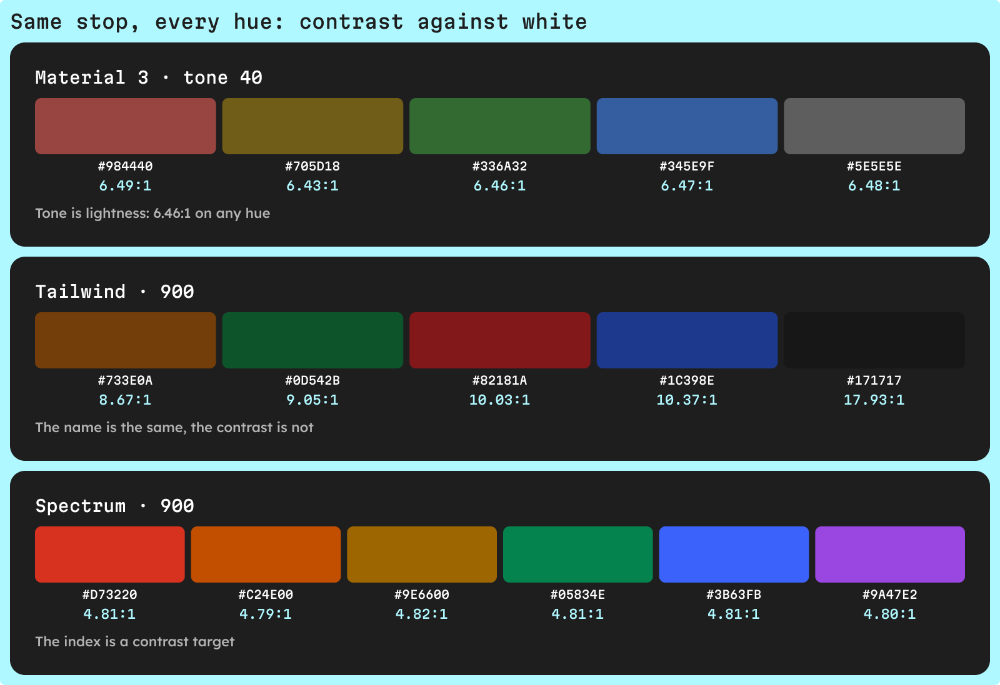
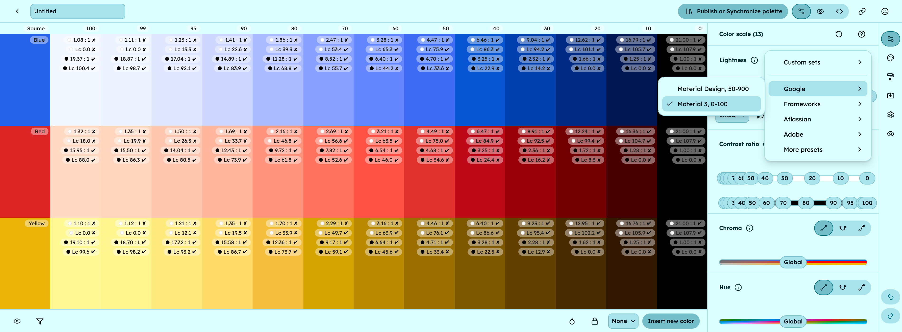

Material 3 numbers its colors by tone, from 0 (black) to 100 (white), and tone is lightness: two tones 50 apart reach about 4.5:1 contrast on any hue. Tailwind names 11 stops from 50 to 950 that only give the order, so the same stop has a different contrast from one hue to the next. Adobe Spectrum ranks each stop by its contrast against the background, so blue-900 and yellow-900 pass the same ratio.

## Material 3 vs Tailwind vs Spectrum at a glance

Here are the three systems side by side.

| | Material 3 | Tailwind | Spectrum |
| --- | --- | --- | --- |
| Stop names | Tones 0 to 100 | 50 to 950 | 100 to 1600; gray 25 to 1000 |
| Stops per color | 13 key tones | 11 | 16; gray 13 |
| What the number means | Lightness (L\*), 100 is white | Order only, 50 is lightest | Contrast rank, 100 is lightest |
| Same stop, same contrast on every hue? | Yes | No | Yes, within a few hundredths |
| Contrast rule | Tones 40 apart for 3:1, 50 apart for 4.5:1 | None documented | A target ratio per index |
| Built with | HCT | OKLCH values tuned per hue | Leonardo, from contrast targets |

Below: how each system works, which one to pick, and how to apply each in UI Color Palette.

## How does Material 3 name its colors?

Material 3 builds each color as a tonal palette in HCT, a color space that combines the hue and chroma of the CAM16 appearance model with the lightness of [CIELAB](/glossary/cielab). The number on a color is its tone, and Material's color utilities state that tone ["is equivalent to L\* in the L\*a\*b\* color space"](https://github.com/material-foundation/material-color-utilities/blob/main/typescript/contrast/contrast.ts). A tonal palette shows 13 key tones: 0, 10, 20, 30, 40, 50, 60, 70, 80, 90, 95, 99 and 100.

Tone is computed from luminance alone, so the WCAG 2 ratio between two tones is the same whatever the hue. Contrast becomes subtraction. Material's [science of color post](https://m3.material.io/blog/science-of-color-design) gives the rule: a tone difference of 40 gives at least 3:1, and 50 gives 4.5:1.

We checked it with the WCAG 2 formula. The weakest pair 40 apart, tone 60 on 100, reaches 3.17:1. The weakest pair 50 apart, tone 50 on 100, lands at 4.48:1, a hair under 4.5:1, so leave a margin for body text.

Roles then pick tones. In Material's [2021 color spec](https://github.com/material-foundation/material-color-utilities/blob/main/typescript/dynamiccolor/color_spec_2021.ts), primary is tone 40 in the light theme and 80 in the dark one, and on-primary text is 100 and 20: 6.46:1 and 7.72:1. Surface sits at tone 98 in light and 6 in dark, so the 13 key tones are anchors, not the full list.

## How does Tailwind name its colors?

Tailwind's default palette gives every color 11 steps, ["with 50 being the lightest, and 950 being the darkest"](https://tailwindcss.com/docs/colors). Tailwind v4 writes them in OKLCH. The numbers set the order; they are not a measured lightness or contrast, and the colors page documents no contrast rule.

Each hue is tuned on its own, so the same stop carries a different contrast. Against white, using the hex values Tailwind lists:

| Tailwind 900 | Hex | vs white `#FFFFFF` |
| --- | --- | --- |
| yellow-900 | `#733E0A` | 8.67:1 |
| green-900 | `#0D542B` | 9.05:1 |
| red-900 | `#82181A` | 10.03:1 |
| blue-900 | `#1C398E` | 10.37:1 |
| neutral-900 | `#171717` | 17.93:1 |

The gaps between stops are uneven too: neutral-400 `#A1A1A1` is 2.58:1 and neutral-500 `#737373` is 4.74:1. You learn which stop passes for text hue by hue.

## How does Adobe Spectrum name its colors?

Spectrum generates its colors with Adobe's Leonardo tool, from key colors ["combined with target contrast ratios for each color"](https://spectrum.adobe.com/page/color-system/). The index ranks contrast: the higher the number, the stronger the contrast against the light theme's background.

In Adobe's [current Spectrum tokens](https://github.com/adobe/spectrum-design-data/blob/main/packages/tokens/src/color-palette.json), each color has 16 stops, from 100 to 1600, and gray has 13, from 25 to 1000. Version 12 of the tokens package used 100 to 1400 for colors and 50 to 900 for grays.

Because each index has a contrast target, the same stop behaves the same on every hue. In the light theme, 900 sits between 4.79:1 and 4.82:1 against white for red, orange, yellow, green, blue and purple, and every 800 stays under 4:1. One rule, "text on white starts at 900", covers the whole palette. Spectrum's guidelines add that its gray and color tokens for text and icons meet WCAG minimums on its background layers.

## Which color scale should you pick?

Start from the convention your code already uses. If you are free to choose, pick the logic you want the numbers to carry.

- **Material 3** — when you build on Material components or Android, or want contrast you can compute from the names: "50 tones apart" works on every hue.
- **Tailwind** — when your front end is Tailwind: 50 to 950 are the class names your team already writes. Budget a contrast check per hue.
- **Spectrum** — when you want one pairing rule for every color, because the index is the contrast target. It's the model to copy if you set your own targets.
- **Your own** — when none fits, a scale with the count and names your system needs.

## How do you apply each scale in UI Color Palette?

UI Color Palette has a preset for each of these [color scales](/glossary/color-scale), in its Figma, Penpot, Sketch and Framer plugins. A preset sets the stops, their names and their starting lightness; the color engine computes every shade from your source colors. You get your colors on their scale, not Google's, Tailwind's or Adobe's colors.

| Preset | Stops | Starting lightness | Plan |
| --- | --- | --- | --- |
| Material 3 | 13, from 0 to 100 | Each stop at its own number | Free |
| Tailwind | 11, from 50 to 950 | 96 down to 16, in steps of 8 | Free |
| Spectrum | 13, from 100 to 1300 | 96 down to 16, in steps of about 6.7 | /pro |
| Spectrum Neutral | 11, from 50 to 900 | 100 down to 0, in steps of 10 | /pro |

- **Stops are fixed** — a preset keeps its own stops: you can't add or remove one. A `Custom` set takes up to 6 stops on /basic and 24 on /pro.
- **Material 3 in LCH** — lightness follows the palette's color space, and new palettes start in OKLCH. Switch to LCH, free on every plan: its L is the CIELAB lightness Material's tone is equivalent to, so "50 apart" carries over closely. Hue and chroma come from LCH, not HCT, so your shades won't match Material Theme Builder's; to see how the two differ, read [UI Color Palette vs Material Theme Builder](/compare/ui-color-palette-vs-material-theme-builder). Surface tones such as 98 and 6 aren't stops of the preset.
- **Tailwind** — the names match Tailwind's palette, so a color named Brand becomes `bg-brand-600`. Our [Tailwind v4 OKLCH guide](/blog/tailwind-v4-oklch-palette-from-figma) covers the export to `@theme`.
- **Spectrum** — the preset covers 100 to 1300, and Spectrum Neutral follows the grays of version 12, with 11 stops: 50, 75, 100, then 200 to 900. Adobe's current 1400 to 1600, gray 25 and gray 1000 have no stop in them. To copy Spectrum's logic, switch the scale from `Lightness` to `Contrast ratio` and set each stop's target ratio, from 1 to 21, against the light or dark foreground color. [How to build an accessible color scale](/blog/how-to-build-an-accessible-color-scale) gives a full set of targets.
- **Check every shade** — each one shows its WCAG 2.1 ratio and APCA score against your light and dark foreground colors; hover a ratio to see its A, AA or AAA grade.

The docs list every preset in [Choose a lightness scale preset](https://docs.ui-color-palette.com/guides/create-a-color-palette#choose-a-lightness-scale-preset).

## Next steps

- **See all 16 presets** — the [design system presets](/capabilities/design-system-presets) page lists every scale UI Color Palette offers, its stops and its plan.
- **Ship the Tailwind version** — [generate a Tailwind v4 OKLCH palette from Figma](/blog/tailwind-v4-oklch-palette-from-figma) takes the preset to an `@theme` block.
- **Set contrast targets** — [how to build an accessible color scale](/blog/how-to-build-an-accessible-color-scale) gives each stop a ratio, Spectrum-style.
