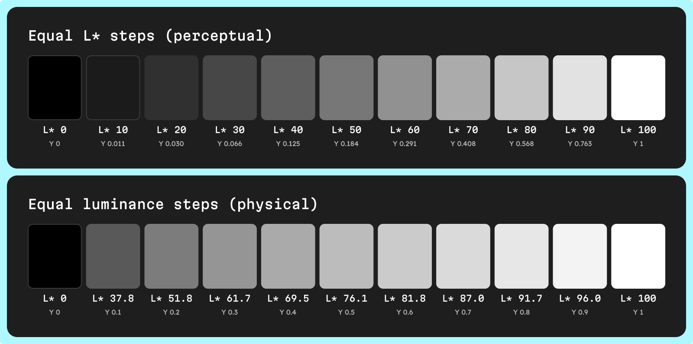

Perceptual lightness is how light a color looks, measured on a scale where equal steps look equal. CIE L*, OKLab L and HSLuv L all measure it.

None of them is luminance. They follow roughly the cube root of the light a color sends out, so `#777777`, the gray that looks halfway between black and white, sends out only 18.4% of the light of white. That gap explains why HSL scales look uneven, how WCAG ratios behave, and how to space a scale, a dark theme or a grayscale check.

## What is the difference between luminance and lightness?

- **Luminance (Y)** — the amount of light a color sends out, relative to white, from 0 to 1. It is physics, and it is what the [WCAG 2.1 relative luminance](https://www.w3.org/TR/WCAG21/#dfn-relative-luminance) computes, weighting the linear red, green and blue channels by 0.2126, 0.7152 and 0.0722.
- **Lightness** — how light the color looks, from black to white. It is perception: equal steps of lightness look equal, equal steps of luminance do not.

The eye is far more sensitive to differences in the darks. Add 0.01 of luminance to a near-black and CIE L* moves 6.5 points, from 9.0 to 15.5; add the same 0.01 near white and it moves 0.4, from 96.0 to 96.4.

Three lightness scales cover most UI work:

| Lightness | Used by | Range | Defined from |
| --- | --- | --- | --- |
| CIE L* | [CIELAB](/glossary/cielab), LCH | 0 to 100 | Luminance, CIE, 1976 |
| OKLab L | [OKLab](/glossary/oklab), OKLCH | 0 to 1 | Cone responses, Björn Ottosson, 2020 |
| HSLuv L | [HSLuv](/glossary/hsluv) | 0 to 100 | CIELUV L*, the same value as CIE L* |

## Why is lightness a cube root of luminance?

CIE L* is defined as **L* = 116 · Y^(1/3) − 16**, with Y relative to white. Below Y ≈ 0.0089, the very darkest values, a straight line takes over: L* = 903.3 · Y. The constants are in the [CSS Color 4 sample code](https://www.w3.org/TR/css-color-4/#color-conversion-code).

Solve it for the middle and L* 50 gives Y = (66 ÷ 116)³ = 0.184. [CSS Color 4](https://www.w3.org/TR/css-color-4/#cie-lab) puts it plainly: "L=50% or 50 is mid gray, by design, and equal increments in L are evenly spaced visually."

| CIE L* | Gray | Luminance Y | OKLab L | Contrast with white |
| --- | --- | --- | --- | --- |
| 20 | `#303030` | 0.030 | 0.309 | 13.20:1 |
| 40 | `#5E5E5E` | 0.112 | 0.482 | 6.48:1 |
| 50 | `#777777` | 0.184 | 0.569 | 4.48:1 |
| 60 | `#919191` | 0.283 | 0.657 | 3.15:1 |
| 80 | `#C6C6C6` | 0.565 | 0.827 | 1.71:1 |

OKLab has the same shape: [Ottosson's model](https://bottosson.github.io/posts/oklab/) applies a cube root to the response of each cone type. For any gray, OKLab L is the cube root of Y, so L* = 116 × OKLab L − 16: `#777777` gives 116 × 0.569 − 16 ≈ 50.

## How far off is HSL lightness from perceptual lightness?

HSL lightness is "simply the mean of the gamma-corrected red, green and blue components," in the words of [CSS Color 4](https://www.w3.org/TR/css-color-4/#the-hsl-notation). It skips the cube root and ignores that the eye weighs green far above blue (see [OKLCH vs HSL for UI palettes](/blog/oklch-vs-hsl-for-ui-palettes)). Here is how far it lands from the perceptual scales on the same colors.

| Color | HSL L | Luminance Y | CIE L* | OKLab L | Contrast with white |
| --- | --- | --- | --- | --- | --- |
| Yellow `#FFFF00` | 50% | 0.928 | 97.1 | 0.968 | 1.07:1 |
| Gray `#808080` | 50% | 0.216 | 53.6 | 0.600 | 3.95:1 |
| Red `#FF0000` | 50% | 0.213 | 53.2 | 0.628 | 4.00:1 |
| Gray `#777777` | 47% | 0.184 | 50.0 | 0.569 | 4.48:1 |
| Blue `#3F75CE` | 53% | 0.182 | 49.8 | 0.571 | 4.52:1 |
| Blue `#0000FF` | 50% | 0.072 | 32.3 | 0.452 | 8.59:1 |

Values use D65 white, the white of sRGB and WCAG. Three readings:

- **HSL 50% means nothing fixed** — it spans L* 32.3 to 97.1.
- **`#808080` is not mid gray** — it sits at L* 53.6; `#777777` is the one at 50.
- **L* follows luminance, OKLab L nearly does** — red and `#808080` share a luminance of about 0.21, yet OKLab rates the red lighter, 0.628 against 0.600.

## How does lightness relate to WCAG contrast and APCA?

The WCAG 2 ratio is (Y of the lighter color + 0.05) ÷ (Y of the darker + 0.05). Lightness does not appear in it, but since CIE L* is computed from Y alone, two colors at the same L* get the same ratio against any third color, up to hex rounding. Look at `#777777` and `#3F75CE` above: 0.2 apart in L*, 4.48:1 and 4.52:1 against white.

The numbers worth remembering:

- **`#767676`** is the lightest gray that passes 4.5:1 on white, at 4.54:1; mid gray `#777777` misses at 4.48:1.
- **The WCAG midpoint** — the gray equally far from white and black has Y 0.179 and L* 49.4. `#757575` comes closest: 4.61:1 against white, 4.56:1 against black.
- **OKLab L is close, not exact** — it weighs cone responses separately, so saturated hues at one OKLab L spread out. In [how to build an accessible color scale](/blog/how-to-build-an-accessible-color-scale), four colors at OKLCH 57% range from 4.21:1 to 4.79:1.

APCA also starts from luminance, but it weighs text and background differently depending on which one is lighter. [APCA in a Nutshell](https://git.apcacontrast.com/documentation/APCA_in_a_Nutshell.html) says WCAG 2 "overstates contrast for dark colors to the point that 4.5:1 can be functionally unreadable when one of the colors in a pair is near black." The midpoint gray shows it: `#757575` text passes 4.5:1 on white and on black, but scores Lc 72.0 on white and Lc −29.6 on black, under the Lc 30 floor APCA sets for any text. We compare both methods in [APCA vs WCAG 2](/blog/apca-vs-wcag-2-what-changes-for-ui-colors).

## How do designers use perceptual lightness?

### Space scales in lightness, check them in contrast

Set your stops in L* or OKLab L so the steps look even on every hue. Equal lightness steps give unequal ratios, and that is fine: contrast targets decide which pairs carry text.

### Build dark mode from the bottom of the scale

Space dark surfaces in L*, as you do light ones: L* 10 to 20 (`#1B1B1B` to `#303030`) is 1.31:1, about the same as L* 80 to 90 (1.32:1). For text on those surfaces, don't stop at 4.5:1: check the APCA score too.

### Check hierarchy in grayscale

Two colors at the same lightness differ by hue alone, and some people don't see hue. If an error red and a success green land at close L*, give them different lightness or add an icon or a label.

A grayscale preview is a quick look, not a measurement. Filters that use luma weights (0.299, 0.587, 0.114) on the encoded RGB channels turn pure blue into `#1D1D1D`, L* 10.8 instead of 32.3.

## How do you set lightness in UI Color Palette?

UI Color Palette builds every scale on the lightness of the palette's color space, in its Figma, Penpot, Sketch and Framer plugins.

- **Each stop is a lightness** — in the `Lightness` view of the scale, a stop's value from 0 to 100 is the lightness of the color space: L* in LCH, L in OKLCH (a stop at 50 is 0.5), L in HSLuv.
- **Pick the color space** — OKLCH is the default (see [LCH vs OKLCH](/blog/lch-vs-oklch-for-design-systems) for the choice); LCH and HSL work on every plan; CIELAB, OKLab and HSLuv need /pro. Switching recomputes the shades and keeps your scale and source colors.
- **Read every shade** — each shade shows its WCAG 2.1 ratio and APCA score against your light and dark foreground colors; hover a ratio to see its A, AA or AAA grade.
- **Type contrast instead** — switch the scale to `Contrast ratio` and enter the ratio each stop must reach, from 1 to 21. The docs note this works very well with HSLuv, whose lightness is L*.
- **Give dark mode its own stops** — each color mode has its own scale and foreground colors. /basic includes 2 custom color modes.
- **Preview in grayscale on /pro** — pick `Achromatopsia` as the vision simulation in the settings, for the active color mode, or in a color mode's parameters. It shows the palette in gray with those luma weights, not luminance, so read the scores rather than the gray.

<!-- TODO(asset): Screen Studio clip, 10–15 s, no audio. 1) Open a palette with a gray, a blue and a yellow source color, scale in `Lightness` view; 2) set one stop to 50 (zoom on the knob value); 3) open the palette settings and switch the color space from OKLCH to LCH (zoom on the dropdown); 4) hover the WCAG ratio of the gray shade at that stop to show its grade. Expected result: in LCH the gray shade at stop 50 is close to #777777 with about 4.48:1 against white, and the three shades at that stop show close ratios; check on the real palette before recording. File: public/videos/perceptual-lightness-explained-stop-50.mp4. Caption link: "Set a stop to lightness 50 and compare its shades in LCH in UI Color Palette". -->

[Compare every color space UI Color Palette supports →](/capabilities/oklch-lch-color-spaces)
