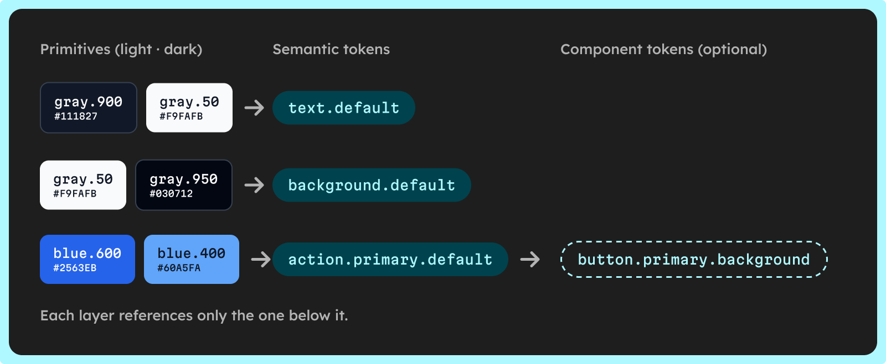

Semantic color tokens name a color by its job in the interface, such as `text.default` or `action.primary.hover`, and point to a primitive token that holds the raw value, such as `color.blue.600`. Structure them in layers: primitives for the palette, semantic tokens for roles, and component tokens only where a component has to diverge, with components never reading primitives directly.

That indirection lets a dark theme, a rebrand or a second brand change values without touching a component. Below: naming, light and dark mappings, DTCG and CSS aliases, and the common mistakes. If you need the basics first, see [what a design token is](/glossary/design-token).

## What are the layers of a color token system?

A color token system has two layers, sometimes three, and each references only the one below it.

- **Primitive tokens** — every shade of the palette, named by hue and stop: `color.blue.600` holds `#2563EB`. They carry no meaning and change only when the palette does.
- **Semantic tokens** — the roles: `background.default`, `text.subtle`, `action.primary.default`. Each one holds a reference to a primitive, and can point to a different primitive in each mode.
- **Component tokens (optional)** — `button.primary.background` points to `{action.primary.default}`. Add them only when one component must change without dragging every other use of the role with it.

Components read semantic or component tokens, never `color.blue.600` directly.



## Why does the indirection pay off?

- **Dark mode without rewriting components** — `text.default` points to gray.900 in light mode and gray.50 in dark mode; the component's CSS stays the same.
- **Rebrands and new themes in one place** — moving from blue to violet means rebinding the `action.primary.*` tokens to violet primitives, and every component that uses the role follows. A high-contrast theme or a second brand is just another set of bindings.
- **Contrast checked once per pair** — you audit `text.subtle` on `surface.default` once, and the result holds wherever that pair appears.

## How should you name semantic color tokens?

Name a token by its use, then narrow it down:

1. **Property** — `background`, `surface`, `text`, `border`, `action`.
2. **Role** — `primary`, `danger`, `success`, or `default` for the neutral case.
3. **Emphasis** — `subtle`, `strong`, or nothing for the default weight.
4. **State** — `hover`, `pressed`, `disabled`, left out for the resting state.

That gives `text.subtle`, `border.strong`, `action.primary.hover` or `background.danger.subtle`. Three rules keep the set readable:

- **One order everywhere** — `action.primary.hover`, never `hover.action.primary` in another file.
- **Words, not numbers** — `text.subtle`, not `text.600`. Stops belong to primitives.
- **Pair content with its container** — Material 3 does it with `primary` and `on-primary`, the color of content placed on primary. In its [baseline scheme](https://github.com/material-components/material-components-android/blob/master/docs/theming/Color.md), primary uses tone 40 in light mode and tone 80 in dark mode, while on-primary is white in light mode and tone 20 in dark mode. See the [Material 3 color roles](https://m3.material.io/styles/color/roles) for the full set.

One constraint comes from the format: the [DTCG specification](https://www.designtokens.org/tr/2025.10/format/#character-restrictions) forbids `{`, `}` and `.` in token and group names, because the dot separates the path in an alias. So `action.primary.hover` is three nested groups, not one name.

## How do you map primitives to semantic tokens in light and dark mode?

Here is a small semantic layer over the gray, blue and red scales of [Tailwind CSS v3](https://v3.tailwindcss.com/docs/customizing-colors), plus white. Each text or fill token is checked against the token it sits on, with the WCAG 2 contrast formula. The level AA targets are 4.5:1 for body text ([SC 1.4.3](https://www.w3.org/WAI/WCAG22/Understanding/contrast-minimum.html)) and 3:1 for the borders of controls ([SC 1.4.11](https://www.w3.org/WAI/WCAG22/Understanding/non-text-contrast.html)).

| Semantic token | Light mode | Dark mode | Checked on | Light | Dark |
| --- | --- | --- | --- | --- | --- |
| `background.default` | gray.50 `#F9FAFB` | gray.950 `#030712` | — | — | — |
| `surface.default` | gray.100 `#F3F4F6` | gray.900 `#111827` | — | — | — |
| `text.default` | gray.900 `#111827` | gray.50 `#F9FAFB` | `background.default` | 16.98:1 | 19.27:1 |
| `text.subtle` | gray.600 `#4B5563` | gray.400 `#9CA3AF` | `surface.default` | 6.87:1 | 6.99:1 |
| `text.danger` | red.600 `#DC2626` | red.400 `#F87171` | `background.default` | 4.62:1 | 7.28:1 |
| `border.strong` | gray.500 `#6B7280` | gray.500 `#6B7280` | `background.default` | 4.63:1 | 4.16:1 |
| `text.on-action` | white `#FFFFFF` | gray.950 `#030712` | — | — | — |
| `action.primary.default` | blue.600 `#2563EB` | blue.400 `#60A5FA` | `text.on-action` | 5.17:1 | 7.92:1 |
| `action.primary.hover` | blue.700 `#1D4ED8` | blue.300 `#93C5FD` | `text.on-action` | 6.70:1 | 11.17:1 |

What the table shows:

- **Names stay, values flip** — text goes from dark gray to near white, backgrounds the other way.
- **Hover moves away from the background** — darker in light mode (blue.700), lighter in dark mode (blue.300). A rule such as "hover is one stop darker" breaks in dark mode, so bind each mode explicitly.
- **A token can keep one primitive** — `border.strong` uses gray.500 in both modes and clears 3:1 on both backgrounds.
- **Content follows its fill** — `text.on-action` switches from white to gray.950 because the dark-mode fill is lighter.

## How do you write aliases in DTCG and CSS?

### DTCG

In the [DTCG format](https://www.designtokens.org/tr/2025.10/format/#aliases-references), an alias is a `$value` written as a token path in curly braces, and it resolves to the `$value` of that token. In this example, the primitive holds the color, written as the [Color module](https://www.designtokens.org/tr/2025.10/color/) defines it:

```json
{
  "color": {
    "blue": {
      "600": {
        "$type": "color",
        "$value": { "colorSpace": "srgb", "components": [0.1451, 0.3882, 0.9216], "hex": "#2563eb" }
      }
    }
  }
}
```

The semantic file only holds references:

```json
{
  "action": {
    "primary": {
      "default": { "$type": "color", "$value": "{color.blue.600}" }
    }
  }
}
```

For dark mode, keep the same names in a second semantic file that points to `{color.blue.400}`, and let your build load the file of the active mode. The specification also accepts JSON Pointer references, such as `"$ref": "#/color/blue/600/$value"`.

### CSS custom properties

```css
:root {
  --color-blue-400: #60a5fa;
  --color-blue-600: #2563eb;
  --action-primary-default: var(--color-blue-600);
}

:root[data-theme='dark'] {
  --action-primary-default: var(--color-blue-400);
}

.button-primary {
  background: var(--action-primary-default);
}
```

Override the semantic variable per theme, never the primitive. A custom property holding `var()` is resolved where it is declared, so redefining `--color-blue-600` inside a component leaves `--action-primary-default` on `:root` unchanged.

## What are the common mistakes with semantic tokens?

### Semantic names that encode a color

`text.blue` or `background.light-gray` stop being true the day dark mode or a rebrand arrives. If a name would have to change when its value changes, it is a primitive in disguise.

### Too many tokens

A semantic token per component and state rebuilds the component layer inside the semantic one. Start with the roles your interface uses, add a token when two places need different values, and delete tokens nothing reads.

### Skipping contrast on pairs

A token has no contrast on its own; a pair does. In the table, `text.danger` passes on `background.default` at 4.62:1, but on `surface.default` it drops to 4.39:1, under 4.5:1. Bind it to red.700, which reaches 5.88:1 on that surface, or document that it never sits on a surface.

Reused light values fail the same way: blue.600 as link text on gray.950 is only 3.90:1. To plan pairs from the stops up, see [how to build an accessible color scale](/blog/how-to-build-an-accessible-color-scale).

### Components that read primitives

Each `var(--color-blue-600)` inside a component bypasses the semantic layer. Lint for primitive names outside your token files.

## How does UI Color Palette fit?

UI Color Palette makes the primitives in your design tool and builds the semantic layer on top of them with Claude, the MCP server or the API. The semantic layer never changes the palette.

- **Primitives in your design tool** — in Figma, Penpot, Sketch and Framer, your source colors and scale produce the shades. You can sync them with each tool's native variables, tokens or styles on every plan, and the plugins' Export writes the primitives.
- **Semantic layer with Claude** — `/ui-color-palette:build-color-system` lets you pick a naming pattern (Role × State, Role × Prominence × State, Surface × Content, or your own), proposes a shade for each token, and lets you refine the bindings before you confirm. A binding has a default shade and can point to another one per theme.
- **Same engine through MCP and the API** — `get_color_system` resolves every token for every theme.
- **Gaps stay visible** — a token with no binding stays in the output, flagged as unbound; a token marked as excluded is left out of every file.
- **Code next to the primitives** — `generate_code` with the color system writes the primitives file and a semantic file whose tokens reference them, in every format, from CSS to DTCG. Native tokens merge both into `tokens.json`.
- **Design files through Claude** — the Figma skill creates a semantic variable collection that references the primitive variables, and the Penpot skill adds semantic tokens that reference the primitive tokens.

<!-- TODO(asset): Screen capture (still), Claude desktop, light mode, 2x. In a session with a palette already scaled (gray, blue, red; Light and Dark themes), run /ui-color-palette:build-color-system with the Role × Prominence × State pattern, accept the proposed bindings, and capture the resolved token matrix that Claude displays (tokens in rows, Light and Dark shades in columns). Crop to the matrix and the line above it; no account data. File: src/assets/blog/primitive-vs-semantic-color-tokens/claude-token-matrix.png. Alt: "Claude showing a resolved semantic token matrix, each token bound to one shade in light mode and one in dark mode". -->

## Next steps

- **Build the semantic layer on your palette** — the [semantic color system](/capabilities/semantic-color-system) page shows the naming patterns, the outputs and how to start with Claude.
- **Ship the primitives as tokens** — [export design tokens](/capabilities/export-design-tokens) to DTCG, Style Dictionary or native tokens from your design tool, on /pro.
