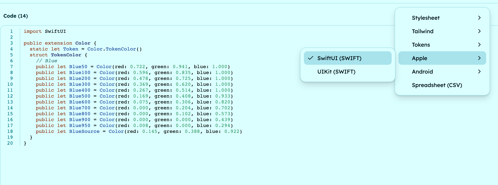
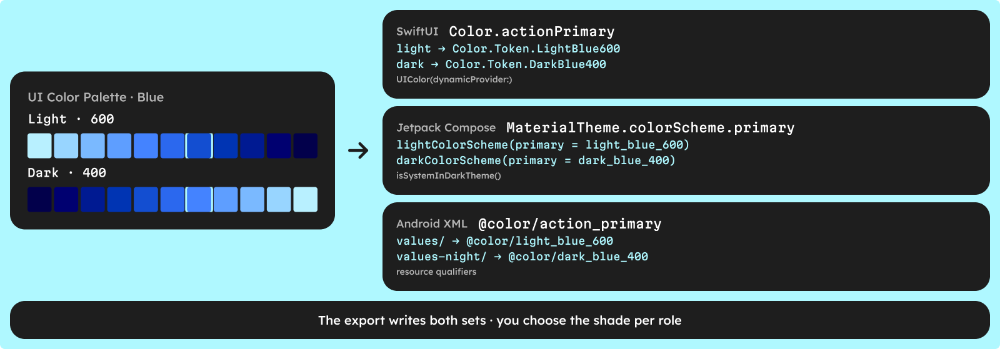

To set up a SwiftUI or Jetpack Compose color palette, build the scale once in Figma, export it as Swift or Kotlin code, and connect the light and dark constants to a role such as `actionPrimary`. In SwiftUI, a palette is an extension on `Color` or one color set per shade; in Compose it is a set of `Color(0xFF…)` values passed to a light and a dark color scheme.

Below: how each platform defines colors, what the UI Color Palette export writes, and how to connect two color modes to the system appearance.

**What you need**: [UI Color Palette in Figma](/figma), Xcode or Android Studio. The palette, the Tailwind and Material 3 presets and the contrast scores are free on /basic. The Apple and Android exports need /pro, and work the same in Penpot and Sketch. Framer does not offer them.

## How do SwiftUI and UIKit define colors?

Apple gives you two places for colors: code and the asset catalog.

- **In code** — SwiftUI's [`Color(red:green:blue:)`](https://developer.apple.com/documentation/swiftui/color/init(_:red:green:blue:opacity:)) takes red, green and blue components from 0 to 1, in sRGB unless you pass another color space. UIKit's `UIColor(red:green:blue:alpha:)` does the same with an alpha.
- **In the asset catalog** — a Color Set holds one value per appearance (Any, Dark, and optionally high contrast). You load it with `Color("name")` or `UIColor(named:)`, and the [system picks the right variant](https://developer.apple.com/documentation/uikit/supporting-dark-mode-in-your-interface) when the appearance changes.

A color built from fixed components never adapts on its own. To make a code color follow dark mode, wrap it in a dynamic color, shown in step 5.

## How does Jetpack Compose define colors?

Compose colors are Kotlin values. [`Color(0xFF134ED1)`](https://developer.android.com/reference/kotlin/androidx/compose/ui/graphics/package-summary#Color(kotlin.Long)) reads as ARGB: `FF` is the alpha, fully opaque, and `134ED1` is the hex value.

You then map them to roles. Material 3 apps pass a [`lightColorScheme` or `darkColorScheme`](https://developer.android.com/develop/ui/compose/designsystems/material3#color-scheme) to `MaterialTheme`, pick one with `isSystemInDarkTheme()`, and read `MaterialTheme.colorScheme.primary` in composables.

Apps that still use Views keep colors in `res/values/colors.xml` as `<color>` resources. Compose can read them with `colorResource(R.color.blue_600)`, though Android recommends theme colors for Compose code.

| Platform | Where the palette lives | Value form | Dark mode |
| --- | --- | --- | --- |
| SwiftUI | `Color` extension or asset catalog | `Color(red: 0.075, green: 0.306, blue: 0.820)` | Asset catalog appearances or a dynamic color |
| UIKit | `UIColor` constants or asset catalog | `UIColor(red:green:blue:alpha:)` | Asset catalog appearances or `UIColor(dynamicProvider:)` |
| Jetpack Compose | Kotlin file, then a color scheme | `Color(0xFF134ED1)` | `lightColorScheme` / `darkColorScheme` with `isSystemInDarkTheme()` |
| Android Views | `res/values/colors.xml` | `#134ed1` | Same name in `res/values-night/` |

## 1 · Build the palette in Figma

Add your source colors, for example a Blue at `#2563EB`, and pick a scale. The Tailwind and Material 3 presets are free with fixed stops. A Custom set lets you choose your stops: up to 6 on /basic, 24 on /pro.

If your app has a light and a dark appearance, add two color modes and name them Light and Dark. /basic includes 2 custom color modes. The names matter: the export puts each mode's name in front of every constant.

## 2 · Check the contrast before you export

Every shade shows its WCAG 2.1 ratio and APCA score against your light and dark text colors, on every plan. Hover a WCAG ratio to see its grade: A, AA or AAA. Fix a failing pair here, not in Xcode.

With the Tailwind preset on `#2563EB`, white text gives:

- **Blue 600, `#134ED1`** — 6.91:1, passes AA for body text (4.5:1).
- **Blue 500, `#2B68EE`** — 4.86:1, passes AA.
- **Blue 400, `#4483FF`** — 3.54:1, large text and icons only.

To set contrast targets per stop, follow [how to build an accessible color scale](/blog/how-to-build-an-accessible-color-scale).

## 3 · Export SwiftUI or UIKit for Xcode

Open Export, then choose SwiftUI (SWIFT) or UIKit (SWIFT) under Apple. Copy the code, or download a `.swift` file named after your palette. For a single color mode, the SwiftUI file looks like this:

```swift
import SwiftUI

public extension Color {
  static let Token = Color.TokenColor()
  struct TokenColor {
    // Blue
    // ...
    public let Blue600 = Color(red: 0.075, green: 0.306, blue: 0.820)
    public let Blue500 = Color(red: 0.169, green: 0.408, blue: 0.933)
    // ...
  }
}
```

Drag the file into your Xcode project and use a shade anywhere a `Color` fits:

```swift
Button("Pay") { }
  .foregroundStyle(.white)
  .background(Color.Token.Blue600)
```

The source color gets its own constant, `BlueSource`. With Light and Dark modes, the names become `LightBlue600` and `DarkBlue600`, all in the same struct. The UIKit file wraps `static let Blue600 = UIColor(red: 0.075, green: 0.306, blue: 0.820)` constants in `struct Color { … }`: flat with one mode (`Color.Blue600`), nested per color mode with several (`Color.Light.Blue600`). It doesn't compile as is in every project: you may need to add `alpha: 1` to each `UIColor`, and `struct Color` can clash with SwiftUI's `Color` in files that import SwiftUI.



## 4 · Export Compose or Resources for Android Studio

Choose Compose (KT) or Resources (XML) under Android. The Compose file holds one top-level value per shade, in snake case:

```kotlin
import androidx.compose.ui.graphics.Color

// Blue
// ...
val blue_600 = Color(0XFF134ED1)
val blue_500 = Color(0XFF2B68EE)
// ...
```

Put the `.kt` file in your theme package, next to `Theme.kt`. The Resources file writes the same shades as `<color>` entries; save it in `res/values/`:

```xml
<?xml version="1.0" encoding="utf-8"?>
<resources>
  <!--Blue-->
  <color name="blue_600">#134ed1</color>
  <color name="blue_500">#2b68ee</color>
</resources>
```

With Light and Dark modes, each name starts with the mode: `light_blue_600`, `dark_blue_600`.

| Export format | File | Value form | One shade | Plan |
| --- | --- | --- | --- | --- |
| SwiftUI (SWIFT) | `.swift` | `Color(red:green:blue:)`, 0–1 | `Color.Token.Blue600` | /pro |
| UIKit (SWIFT) | `.swift` | `UIColor(red:green:blue:)`, 0–1, no `alpha:` | `Color.Blue600` | /pro |
| Compose (KT) | `.kt` | `Color(0XFF134ED1)` | `blue_600` | /pro |
| Resources (XML) | `.xml` | `#134ed1` | `@color/blue_600` | /pro |

All four are written from the same scale, so every platform gets the same shades. Run the export again after each palette change.

## 5 · How do you wire light and dark mode on each platform?

The export gives you one named set of constants per color mode. It does not decide which shade a role uses in each mode, and it does not create asset catalog appearances or `values-night` files. You connect the two sets once, by hand.



A new color mode starts from the same scale, so if you keep its stops, Dark Blue 400 is `#4483FF`, which gives 5.94:1 with black text. Light Blue 600 gives 6.91:1 with white text. Both pass AA.

**SwiftUI.** Declare each role once as a dynamic color. [`UIColor(dynamicProvider:)`](https://developer.apple.com/documentation/uikit/uicolor/init(dynamicprovider:)) resolves it again whenever the appearance changes:

```swift
import SwiftUI

extension Color {
  static let actionPrimary = Color(uiColor: UIColor { traits in
    traits.userInterfaceStyle == .dark
      ? UIColor(Color.Token.DarkBlue400)
      : UIColor(Color.Token.LightBlue600)
  })
}
```

`Color(uiColor:)` needs iOS 15. If you prefer the asset catalog, create a Color Set named after the role, turn on the Dark appearance, and copy the two values from the export.

**Jetpack Compose.** Map roles in two color schemes and let the system setting choose:

```kotlin
private val LightColors = lightColorScheme(primary = light_blue_600, onPrimary = Color.White)
private val DarkColors = darkColorScheme(primary = dark_blue_400, onPrimary = Color.Black)

@Composable
fun AppTheme(darkTheme: Boolean = isSystemInDarkTheme(), content: @Composable () -> Unit) {
  MaterialTheme(colorScheme = if (darkTheme) DarkColors else LightColors, content = content)
}
```

**Android XML.** Keep the exported file in `res/values/`, then alias a role under the same name in `values/colors.xml` and `values-night/colors.xml`. Android [picks the `night` resource](https://developer.android.com/guide/topics/resources/providing-resources) when the system dark theme, available since Android 10, is on:

```xml
<!-- res/values/colors.xml -->
<color name="action_primary">@color/light_blue_600</color>
<!-- res/values-night/colors.xml -->
<color name="action_primary">@color/dark_blue_400</color>
```

These role names are semantic tokens. To name and structure them before your app has dozens, read [primitive vs semantic color tokens](/blog/primitive-vs-semantic-color-tokens).

## Common mistakes

- **Using shades directly in views** — `Color.Token.LightBlue600` in a button locks it to light mode. Views read roles such as `actionPrimary`; only the role definitions read shades.
- **Editing the exported file** — your changes disappear at the next export. Keep the role mappings in a separate file and replace the exported one as a whole.
- **Copying values into two places** — if the asset catalog and the Swift file both hold the same shade, they drift. Pick one source per platform.
- **Forgetting the alpha in Compose** — `Color(0x134ED1)` has an alpha of 00 and draws nothing. Opaque shades in the export already start with `0XFF`.

## Next steps

- **Compare formats and plans** — the [SwiftUI and Jetpack Compose color palette](/capabilities/swiftui-compose-colors) page shows each export and where it is available.
- **Read the format reference** — the docs detail every file in [Export a color palette to code](https://docs.ui-color-palette.com/guides/export-a-color-palette-to-code).
