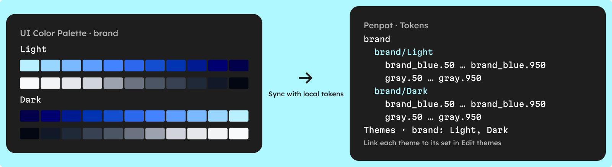

To sync a color palette to Penpot design tokens, build the palette in the UI Color Palette plugin, open the **Synchronize palette** menu and choose **Sync with local tokens**. Every shade becomes a native Penpot color token, grouped by source color, with one token set per color mode, and the sync is free on every plan.

There is no JSON file to export or import: the plugin writes the tokens through Penpot's plugin API. The sync is one-way and safe to repeat: existing tokens are updated in place, never duplicated.

## What are Penpot design tokens?

Penpot design tokens are named values, such as a color, a spacing or a radius, stored in the file and applied to layers from the Tokens panel. According to [Penpot's help center](https://help.penpot.app/user-guide/design-systems/design-tokens/), they follow the [Design Tokens Format Module](https://www.designtokens.org/tr/2025.10/format/) drafted by the W3C Design Tokens Community Group (DTCG), so they export as JSON other tools can read.

Three Penpot concepts matter for a palette:

- **Token sets** — collections of tokens that can be turned on or off. A name such as `Light/Colors` creates a folder ([token sets](https://help.penpot.app/user-guide/design-systems/design-tokens/#design-tokens-sets)).
- **Themes** — each theme lists the sets it activates. Themes sit in groups, and only one theme per group is active at a time ([token themes](https://help.penpot.app/user-guide/design-systems/design-tokens/#design-tokens-themes)).
- **Aliases** — a token can reference another one in curly braces, such as `{blue.500}`, and follows it when that value changes ([aliases](https://help.penpot.app/user-guide/design-systems/design-tokens/#design-tokens-aliases)).

## Should you sync to tokens or to library colors?

UI Color Palette syncs a palette to Penpot in two ways: **Sync with local tokens** and **Sync with local styles**, which adds the shades to the file's library colors. Both are free, both follow the same naming, and you can run both on the same palette.

| | Library colors | Design tokens |
| --- | --- | --- |
| Menu item | Sync with local styles | Sync with local tokens |
| What each shade becomes | A library color, grouped by source color | A color token, grouped by source color |
| Color modes | One group of colors per mode | One token set per mode, plus a Penpot theme per mode that you link to its set |
| Same name, light and dark values | No | Yes: each mode's set uses the same token names |
| Aliases to other tokens | No | Yes, with `{token.name}` |
| Sharing with other files | Publish the file as a shared library | Set the shared library as the file's tokens source |
| Deep sync preference | Deeply synchronize with local styles | Deeply synchronize with local tokens |

Pick tokens when your design system has modes, when you plan semantic tokens on top, or when developers read the JSON. Library colors are fine for a single palette that people pick from by hand.

## How do you sync a palette to Penpot tokens?

### 1 · Build the palette

[Add UI Color Palette to Penpot](/penpot), then create a palette from your source colors. Pick a lightness scale: the Tailwind and Material 3 presets are free, with fixed stops, and a Custom set takes up to 6 stops on /basic and 24 on /pro. The stop names become token names, so choose the scale your developers already use.

Check the WCAG 2.1 and APCA score of each shade before you sync. To set the stops by contrast, see [how to build an accessible color scale](/blog/how-to-build-an-accessible-color-scale).

### 2 · Add color modes if you need them

Each color mode, such as Light and Dark, becomes its own token set. On /basic, a palette has up to 2 color modes; /pro has no cap. A palette without color modes goes into a single set.

### 3 · Name the palette and its colors

Names drive the structure in Penpot:

- **Palette name** — names the token set, or prefixes each set when there are color modes (`brand/Light`, `brand/Dark`). It also names the group of the Penpot themes.
- **Source color name** — becomes the token group in snake_case: "Brand Blue" gives `brand_blue`.
- **Stop name** — completes the token: `brand_blue.500`.

### 4 · Run the sync

Open the **Synchronize palette** menu in the top bar (in a narrow plugin window, it sits in the single actions menu) and choose **Sync with local tokens**. A message reports how many tokens and themes were created or updated.

<!-- TODO(asset): Screen Studio clip, 10–15 s, Penpot in light mode, plugin open on a palette named "brand" with two source colors (Brand Blue, Gray), the Tailwind preset and two color modes (Light, Dark). 1) Zoom on the Synchronize palette menu and open it. 2) Click Sync with local tokens; let the confirmation message show. 3) Cut to Penpot's Tokens panel: expand the brand folder to show the sets brand/Light and brand/Dark, then expand brand_blue to show 50…950. 4) Open Edit themes, select the Light theme of the brand group and tick the brand/Light set; repeat for Dark with brand/Dark. Do not show a theme switch changing shades. File: public/videos/sync-a-color-palette-to-penpot-design-tokens-sync.mp4. Caption line: [Sync a palette with Penpot design tokens from the Synchronize palette menu](/videos/sync-a-color-palette-to-penpot-design-tokens-sync.mp4) -->

## What does the sync create in Penpot?

For a palette named "brand", with Brand Blue and Gray on the Tailwind preset and two color modes, the sync creates:

- **Two token sets** — `brand/Light` and `brand/Dark`, shown as a `brand` folder in the Tokens panel.
- **Two themes** — Light and Dark, in a theme group named `brand`. They are created empty: the sync does not link them to their sets.
- **One color token per shade in each set** — `brand_blue.50` to `brand_blue.950` and `gray.50` to `gray.950`, plus `brand_blue.source` and `gray.source` for the source colors, each holding the shade's hex value.

The two sets share the same token names, so a layer bound to `brand_blue.500` reads the value of whichever set is active. To switch modes with a theme, link each theme to its set yourself: open **Edit themes** in Penpot, select the Light theme and turn on `brand/Light`, then do the same for Dark with `brand/Dark`. A re-sync keeps the themes, so you link them once.

## How do you update the tokens after a change?

The sync is one-way: Penpot never writes back to the palette. After you change a source color, a stop or a color mode, run **Sync with local tokens** again.

- **Existing tokens are updated in place** — their value, name and description follow the palette, and existing sets and themes are reused, never duplicated.
- **Renames carry over** — tokens are matched to their shade, not to their name, so renaming a source color renames its tokens instead of adding new ones.
- **Leftovers stay by default** — a token whose shade left the palette is kept, so nothing that uses it breaks.

To clean leftovers, turn on **Deeply synchronize with local tokens** in the Preferences (user menu). The next sync then deletes every token of the palette's color mode sets, such as `brand/Light`, that no longer matches a shade, including tokens you added there by hand. The single set of a palette without color modes is not cleaned: remove its leftovers in Penpot. Keep your own tokens in a set of their own.

## How do you add semantic tokens on top?

The plugin syncs primitives: one token per shade, named by color and stop. Semantic tokens, such as `text.default` or `action.primary.hover`, name a job and reference a primitive. See [primitive vs semantic color tokens](/blog/primitive-vs-semantic-color-tokens) for how to structure them.

You have two ways to add that layer in Penpot:

- **With Claude** — the UI Color Palette Claude plugin builds the semantic layer with `/ui-color-palette:build-color-system`, then its Penpot skill (`/ui-color-palette:penpot tokens`) adds semantic tokens that reference the primitive tokens. It needs your Penpot URL and access token, set with `/plugin config`.
- **By hand** — create a token in your own set with an alias as its value, such as `{brand_blue.600}`. The next sync updates the primitive, and the alias follows.

## What are the limits and availability?

- **Penpot only** — tokens sync on Penpot. Figma and Sketch sync to variables, and Framer to color styles.
- **Free on every plan** — sync with tokens, sync with library colors and the deep sync preferences. /basic caps the palette at one per page, 5 source colors and 2 color modes.
- **One-way** — editing a token in Penpot does not change the palette.
- **Primitives only** — the plugin creates no semantic tokens; that layer comes from Claude or from your own aliases.
- **Files for code** — Penpot can export its tokens as JSON. Exports from the plugin to DTCG, Style Dictionary or Tailwind are on /pro, CSS is free: see [export colors to DTCG and Style Dictionary](/blog/export-colors-to-dtcg-and-style-dictionary).

Ready to try it? [Add UI Color Palette to Penpot →](/penpot)
